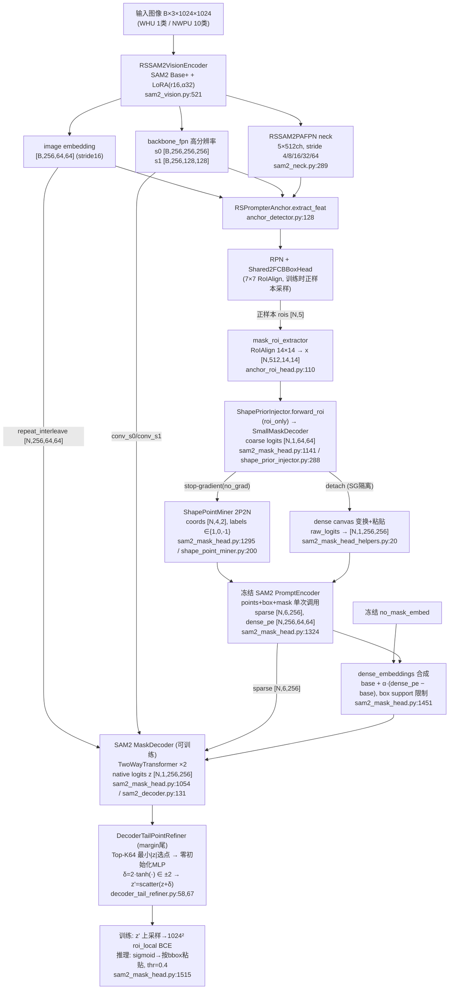

> **清理后版本说明（2026-10-07）**：本文的机制描述、前向顺序、损失与梯度通路、
> 阈值表仍然有效；但文中 `文件:行号` 引用对应**清理前提交 add7482**。当前代码的
> 文件地图与行号请以 `docs/codebase_guide.md` 为准；每轮删除/重构清单见
> `docs/cleanup_rounds.md`（P2BRR/R3/DenseCap/ROI-SAM/quality/置信门尾等死臂已删除，
> 本文中涉及它们的段落仅作历史机制记录）。

# A3sgm 完整架构与前向导览

日期：2026-09-20。性质：**架构讲解文档**——只描述已落盘代码的真实行为，所有论断给出
`文件:行号`；不含未实施的设计。对象读者：需要快速接手/复核 A3sgm 的人。

---

## 0. 一页定位

**A3sgm = "A0-SG 梯度隔离 dense 底座 + 阈值锚定耦合 margin decoder-tail + 解耦辅助梯度裁剪"**。
它是 RSPrompter-anchor 单流检测器（SAM2 Base+ 特征 + 两阶段 RPN/RoI）上，显式
coarse prompt 路线（PBM = points+box+dense mask）的 A 系尾臂收官配方：
在 R1-C4-RD 底座（PAFPN / stride-16 / dense raw-logit detach）上，把
fast150 协议中 P2BoundaryRefiner 的槽位换成 UDPR margin 尾（`residual_v1_margin`）。

三个名字成分的含义（arm 定义：`scripts/ablations/vhr10_p2v2_dev.sh:420-444`）：

| 成分 | 含义 | 代码开关 |
|---|---|---|
| **A3** | SAM2 decoder 尾部的不确定性选点残差精修（UDPR v1 容器） | `DECODER_TAIL_REFINER_ENABLED=1` |
| **sg** | dense 源梯度隔离（A0-SG 底座）：dense canvas 输入从 coarse 计算图 detach | `SHAPE_DENSE_DETACH=1` |
| **m** | margin：点损失从 v1 的 BCE 换成**部署阈值锚定**的单边 margin 违例损失 | `DECODER_TAIL_MODE=residual_v1_margin`，`BOUNDARY_LOGIT=log(0.4/0.6)=-0.405465`，`CROSSING_MARGIN=0.10` |

架构 ID（checkpoint 指纹）：`r1_c4_rd_pafpn_coarse_points_box_raw_detach_emb64_udprk64`
（`rsprompter/architecture_contract.py:103-114,143-151`；margin 模式刻意不加 ID 后缀，保持 A3 容器历史 ID）。

两个正式入口：

- NWPU VHR-10（matrix300 谱系，dev100/matrix300 均有）：arm `a3sgm`，
  run tag `vhr10_p2v2_matrix300_a3sgm_pbm_sg_udprk64tm_*`；
- WHU-1024 全量 fast150：`scripts/ablations/whu1024_a3sgm_roilocal_full_fast.sh`
  （脚本 :27 的 `ABALATION_ID` 即该架构 ID；NWPU 最优配方 × WHU 已验证的 fast150 监督基底）。

当前状态（2026-09-20）：NWPU a3sgm last segm 0.682 / best-composite 0.683 /
best-segm 0.693（`docs/nwpu_gap_analysis_20260919.md:6`）；锚点关闭消融
`a3sgm_b05` last 0.6797（同文档 :232）；WHU 全量 150ep 四卡 fp32 在跑
（`scripts/ablations/queue_whu_a3sgm_4gpu.sh:4-9`）。

---

## 1. 总体架构图（按前向顺序）



---

## 2. 模块清单与冻结状态

| 模块 | 文件 | 状态 | 说明 |
|---|---|---|---|
| SAM2 Hiera Base+ 编码器 | `rsprompter/sam2_vision.py:162` | **冻结 + LoRA 可训练**（r=16/α=32/dropout 0.05，target qkv+proj，`configs/rsprompter_anchor_satS_v11_sam2_large_full.py:112-121`） | `modules_to_save=["neck"]`：SAM2 内部 neck 全可训练 |
| RSSAM2PAFPN | `rsprompter/sam2_neck.py:179` | 可训练 | 四层 SAM2 特征 → FPN+PAN → 五层 512ch |
| RPN / Shared2FCBBoxHead | `configs/rsprompter_anchor_satS_v11_sam2_large_full.py:127-168` | 可训练 | 检测分支；bbox RoIAlign 7×7 |
| ShapePriorInjector（含 SmallMaskDecoder） | `rsprompter/shape_prior_injector.py:114` | 可训练 | ROI-local coarse 64×64 生成器；`fusion_type=roi_only` 不构造任何 FiLM/context 参数 |
| ShapePointMiner | `rsprompter/shape_point_miner.py:26` | 无参数（纯函数式） | 2P2N 点挖掘，no_grad + detach（见附录 A） |
| SAM2 PromptEncoder | `sam2_mask_head.py` 内构建，PE 来自 vendored sam2 | 点/框 embedding 两入口均**冻结**（`freeze_all=True`，`configs/whu1024_baseplus_explicit_coarse.py:279-287`）；**mask 下采样卷积栈（4,684 参数）两入口不同**：WHU 冻结（md=0、LR 组 0.0），NWPU 以 0.1×LR 联合训练（见 §5） | 4,684 = `mask_downscaling` 卷积栈参数（densefix 契约） |
| no_mask_embed | `sam2_vision.py:85` 加载 | **冻结**（`freeze_no_mask_embed=True`） | dense embedding 的基底常量 |
| SAM2 MaskDecoder | `rsprompter/sam2_decoder.py:24` 包装 | **可训练**（`decoder_freeze=False`，`configs/rsprompter_anchor_satS_v11_sam2_large_full.py:100`） | 最终 mask loss 与 margin 尾 loss 都会训练它 |
| dense 门控 α | `shape_dense_alpha_raw` 标量 | 可训练 | `global_sigmoid` 模式，初始 sigmoid⁻¹(0.25)（`sam2_mask_head_helpers.py:141-157`） |
| **DecoderTailPointRefiner（margin 尾）** | `rsprompter/decoder_tail_refiner.py:14` | 可训练（唯一的"新模块"） | 零初始化输出层；A3sgm 本体 |
| P2BoundaryRefiner / R3 / DenseCap / ROI-SAM | — | **全部关闭**（inert locks，`whu1024_a3sgm_roilocal_full_fast.sh:38-64`；P2BRR=0 在 :39） | 不构造参数，不进指纹 |

---

## 3. 前向全链路（按执行顺序）

约定：以 WHU/NWPU 共同形态为准——输入 1024×1024、`SAM_IMAGE_EMBED_STRIDE=16`、
`EXPLICIT_PROMPT_MODE=points_box_dense`（PBM）、`FINAL_MASK_COORDINATE_MODE=roi_local`、
class-agnostic mask。训练入口 `RSPrompterAnchor.loss`（`anchor_detector.py:174-200`），
推理入口 `RSPrompterAnchor.predict`（`anchor_detector.py:202-220`）。

### Step 1 — 特征抽取 `extract_feat`（`anchor_detector.py:128-172`）

```python
vision_outputs = self.backbone(batch_inputs)          # LoRA SAM2 编码器
image_embeddings = self._select_sam_image_embeddings( # stride16 → [B,256,64,64]
    vision_outputs, batch_inputs)                     # anchor_detector.py:94-126
x = self.neck(vision_hidden_states)                   # PAFPN → 5×512ch
high_res_features = [feat_s0, feat_s1]                # [B,256,256,256],[B,256,128,128]
```

- 编码器 forward：`sam2_vision.py:521-543`（梯度检查点可选）。
- stride16 契约：从 SAM2 输出中选 1024/16=64 的特征图作为 decoder 的 image
  embedding（`anchor_detector.py:98-126`，空间大小硬校验）。
- high-res 特征按"embedding 的 4×/2×"自动对位（`anchor_detector.py:153-170`）。

### Step 2 — 检测两阶段（RPN → 正样本采样）

- RPN loss_and_predict + RoI bbox loss：`anchor_detector.py:178-199` →
  `anchor_roi_head.py:539-628`（`loss()`：assigner+sampler，bbox_loss 7×7 RoIAlign）。
- 训练时 prompt 框源唯一：**proposal 框**（`train_box_source="proposal"`，
  `configs/whu1024_baseplus_explicit_coarse.py:380-389`；SABL 源已删除）。
- box jitter：配置默认 `jitter_prob=0.0` 关闭（同文件 :389）；开启时
  `anchor_roi_head.py:248-268` 会同步扰动 RoIAlign 与 prompt 框。
- 产物：`original_pos_rois = [N,5]`（batch_ind+xyxy）；此后一切 mask/prompt 操作
  使用同一组框。

### Step 3 — RoI 特征（mask 分支输入 x）

`_mask_forward`（`anchor_roi_head.py:96-141`）：

```python
mask_feats = self.mask_roi_extractor(x[:4], rois)   # RoIAlign 14×14, strides[4,8,16,32]
mask_head_out = self.mask_head(mask_feats, image_embeddings, ...,
    roi_img_ids, high_res_features, boxes=rois[:,1:],
    p2_feature=x[0], prompt_rois=rois, renderer_features=x)
```

mask_roi_extractor 唯一定义：`configs/rsprompter_anchor_satS_v11_sam2_large_full.py:169-174`
（output_size=14、512ch）。**注意**：这是 gap analysis 认定的小目标边界首要嫌疑
（64px 目标 → 每格 ≈4.6px，`docs/nwpu_gap_analysis_20260919.md:27-31,111-116`）。

以下 Step 4-10 全部发生在 `RSPrompterAnchorMaskHeadSAM2.forward`
（`rsprompter/sam2_mask_head.py:914-1118`）内。

### Step 4 — coarse 生成（`_forward_coarse_p2`，`sam2_mask_head.py:1119-1245`）

```python
ctx_tokens = self.shape_injector.forward_context_visual(image_embeddings)  # roi_only→None
raw_shape_prior_logits, _, _, _ = self.shape_injector.forward_roi(         # :1141
    ctx_tokens, x, boxes, roi_img_ids)
```

`ShapePriorInjector.forward_roi`（`shape_prior_injector.py:288-346`）：`roi_only`
路线直接把 RoI 特征 `[N,512,14,14]` 送 `SmallMaskDecoder`（同文件 :27-60：
Conv-GN-GELU ×2 → ×2 上采样 → Conv-GN-GELU → ×2 上采样 → 128→64 通道
Conv-GN-GELU → 3×3 输出卷积，非整数倍时插值到 64×64）→
**coarse logits `[N,1,64,64]`（ROI-local 坐标系）**。
P2BoundaryRefiner 关闭 → `refined == raw`（`sam2_mask_head.py:1145`）。

coarse 有**三个下游消费者**（这是整条链路的核心分叉点；按前向实际执行顺序排列）：

1. **dense canvas**（Step 5）：`dense_source_logits = shape_prior_mask_logits`
   （`sam2_mask_head.py:1196-1197`；DenseCap/R3 均关闭时不改源），仍在
   `_forward_coarse_p2` 内完成（:1229-1233）；
2. **2P2N 点挖掘**（Step 6）：对 `shape_prior_mask_logits`，矿工内部 no_grad；
3. **coarse 辅助损失**（§4）：直接监督 `raw_logits`。

### Step 5 — dense canvas（raw_logits + detach = SG 隔离，先于点挖掘执行）

`_shape_prior_to_prompt_mask`（`sam2_mask_head_helpers.py:20-98`）：

```python
transformed = transform_coarse_prompt(roi_mask_logits, transform="raw_logits",
    detach_input=True, ...)                      # dense_prompt_utils.py:14-47
prompt = paste_roi_to_full_canvas(transformed, boxes, mask_h=256, mask_w=256, ...)
                                                # dense_prompt_utils.py:292-350
```

- `detach_input=True`（由 `SHAPE_DENSE_DETACH=1` 解析进
  `dense_prompt_cfg.detach_input`，`configs/whu1024_baseplus_explicit_coarse.py:342-344`）
  ——**dense 通道从 coarse 计算图切断，这就是 "sg"**。效果：coarse 头只由
  coarse 辅助损失训练（最终 mask loss 经 dense 通路回不到 coarse 头）；
- raw_logits 变换即恒等（可 clamp ±8）；粘贴：ROI 64×64 双线性 resize 到框在
  canvas 上的投影区域，框外填 0（`outside_fill_logit`）；
- canvas 尺寸从 PE 属性读：stride16 路线 mask 输入 **256×256**
  （`_pe_mask_input_size`，`sam2_mask_head_helpers.py:179-191`）。

### Step 6 — 2P2N 点挖掘（stop-gradient）

`_forward_prompt_encode`（`sam2_mask_head.py:1289-1301`）：

```python
coords, labels, point_stats = self.shape_point_miner(
    shape_prior_mask_logits, prompt_geometry_boxes, self.prompt_encoder_image_size)
```

要点（完整选点规则见**附录 A**）：

- 整个挖掘在 `with torch.no_grad():` 内（`shape_point_miner.py:249`）——点对
  coarse 头**天然无梯度**；
- 4 个点槽固定顺序 `P1,P2,N1,N2`，逐槽在"候选集 ∩ 评分"上取**最大分数平台
  的几何中心**；每槽带显式 fallback 与自适应有效性（无效槽 label=-1，
  PE 编码后置零 `sam2_mask_head_helpers.py:129-139`；全批点槽无效时
  `points=None`，PE 只收到 box token）；
- 坐标映射：coarse 64×64 局部格 → 框内相对坐标 → 1024 图像坐标并 clamp
  （`shape_point_miner.py:501-520`）。产物 `coords [N,4,2]`（图像 xy）、
  `labels [N,4]`（P=1/N=0/无效=-1）。

### Step 7 — 冻结 PromptEncoder 单次调用

`sam2_mask_head.py:1307-1332`：

```python
points_for_pe, boxes_for_pe, masks_for_pe = self._select_explicit_prompt_inputs(
    coords, labels, prompt_geometry_boxes, masks_for_pe)   # PBM: 三者全给
sparse_pe, dense_pe_from_pe = self.prompt_encoder(
    points=points_for_pe, boxes=boxes_for_pe, masks=masks_for_pe)
sparse_pe = self._neutralize_invalid_point_tokens(sparse_pe, labels)
```

- 输入模态由 `explicit_prompt_mode="points_box_dense"` 决定
  （`_select_explicit_prompt_inputs`，`sam2_mask_head_helpers.py:100-126`）；
- 输出：`sparse [N,6,256]`（4 点 token + box 两角点 token）、
  `dense_pe [N,256,64,64]`（mask 下采样卷积栈编码 256×256 canvas）；
- 可训练性两入口不同：点/框 embedding 均冻结；**WHU** 下采样栈也冻结
  （`PROMPT_ENCODER_TRAIN_MASK_DOWNSCALING=0`、`PROMPT_ENCODER_LR_MULT=0.0`，
  `whu1024_a3sgm_roilocal_full_fast.sh:44-45`）；**NWPU** 因 dev 脚本全局默认
  `md=1 / pe_lr=0.1`（`vhr10_p2v2_dev.sh:178-179`，a3sgm arm 未重置），
  4,684 参数的 mask 下采样栈以 0.1×LR 联合训练（训练日志优化器组实证）。

### Step 8 — dense embedding 合成（no_mask 基底 + 门控残差）

`_forward_dense_embeddings`（`sam2_mask_head.py:1451-1512`）：

```python
base_dense = self.no_mask_embed.reshape(1,-1,1,1).expand(roi_bs, 256, 64, 64)
dense_pe = replace_invalid_dense_with_base(dense_pe, base_dense, shape_dense_valid)
dense_pe = base_dense + support * (dense_pe - base_dense)   # 框内 support 限制
dense_embeddings = base_dense + prompt_scale * (dense_pe - base_dense)
```

- `prompt_scale = sigmoid(shape_dense_alpha_raw)`，初始 0.25，可训练
  （`_effective_shape_dense_alpha`，`sam2_mask_head_helpers.py:141-157`）；
- 框外强制回到 no_mask 基底（`_dense_embedding_box_support`，:159-177）；
- 同函数内产出 `DENSE/applied_delta_ratio` 等机制遥测（每 epoch 汇总的
  dense residual monitor 的来源）。

### Step 9 — SAM2 MaskDecoder 前向

`sam2_mask_head.py:1013-1062`：

- image embedding 与 PE 按每个 proposal `repeat_interleave`（N 份）；
  positional embedding 用 PE 的 `get_dense_pe()`（:1018-1026）；
- high-res：`conv_s0/conv_s1` 压到 32/64 通道（`sam2_decoder.py:195-204`）；
- wrapper 调 vendored MaskDecoder（TwoWayTransformer×2，`sam2_decoder.py:206-216`）：
  输出 `low_res_masks z [N,1,256,256]`（embedding 64×64 的 4× 上采样网格）、
  `iou_predictions [N,1]`、`mask_tokens_out`；
- **A3sgm 开启 `capture_upscaled_embedding`**（`sam2_mask_head.py:379`）：在
  `output_upscaling[-1]` 挂 forward hook 抓取 32 通道上采样特征
  （`sam2_decoder.py:111-119,236-242`），供尾臂使用。

### Step 10 — margin 尾（A3sgm 本体）

`sam2_mask_head.py:1063-1086` + `decoder_tail_refiner.py:58-133`：

**(a) 确定性选点** `_select`（`decoder_tail_refiner.py:58-65`）：

```python
flat = logits[:, 0].detach().float().abs().reshape(n, h*w)
indices = torch.argsort(flat, dim=1, stable=True)[:, :K]   # K=64，稳定 tie-break
```

即取 native 256×256 网格上 **|z| 最小（最贴近二值边界）的 64 个点**。

**(b) 逐点特征**（`decoder_tail_refiner.py:81-111`）：

```python
feat   = upscaled.flatten(2).gather(...)      # 32ch 上采样特征 @选中点
token  = mask_tokens[:, 0, :]                 # 单 mask token（每 RoI 一个）
attrs  = stack(z, x_norm, y_norm, |z|)        # 4 维
point_features = cat(feat, token, attrs)      # 32+256+4 = 292 维
```

**关键**：`residual_v1_margin` 属于**耦合**容器——feat/token/选中 logit
**不 detach**（detach 只发生在 `residual_v1_stop*` 分支，
`decoder_tail_refiner.py:93-109`）。这是与 a3sgtm（tailstop 隔离）唯一的
模型级差异：margin 损失可以回传主干（co-adaptation 通道），最终 mask loss
也消费精修后的 z'。

**(c) 残差与写回**（:112-124）：

```python
raw_delta = self.delta_logit_max * torch.tanh(self.mlp(point_features))  # ±2.0
delta = raw_delta                                    # v1/margin 无 gate
refined = flat_logits.scatter(1, indices, selected_logits + delta)      # z' = z + δ
```

MLP：`LayerNorm(292) → Linear(292,128) → GELU → Linear(128,1)`，末层**零初始化**
（:44-46）→ 初始前向严格恒等（A0-SG 起点）。训练与推理都部署 z'
（`sam2_mask_head.py:1068-1072`：仅 tailstop 模式训练时保留未精修 z）。

### Step 11 — 输出、损失目标与推理后处理

- forward 返回 6 元组（`sam2_mask_head.py:1111-1118`）：mask_preds（z'）、
  iou、coarse_outputs、空槽、quality、mask_tokens；
- **训练最终 mask 目标（roi_local）**：`loss_and_target`
  （`sam2_mask_head_targets.py:302-385`）走 `get_targets` → mmdet
  `mask_target(..., rcnn_train_cfg)`，目标尺寸取
  `train_cfg.rcnn.mask_size`——本链路被干净桥接配置显式设为
  **(1024, 1024)**（`configs/whu1024_baseplus_clean.py:69`，两入口均无下游
  覆盖；checkpoint `config_snapshot` 实证）。因此 z' [N,1,256,256] 被双线性
  **上采样到 1024×1024** 后做 BCE（CrossEntropyLoss use_mask，权重 1.0，
  class-agnostic）。注意：`roi_mask_size=28` 默认值（`sam2_mask_head.py:84`）
  在这条链路上是死参数（所有 `get_coarse_targets` 调用点都显式传 mask_size），
  "28×28"是 Mask R-CNN 历史默认、不是本项目的实际目标尺寸；
- **尾点损失目标**：roi_local 模式下用 `get_coarse_targets(mask_size=(256,256))`
  在 decoder 原生网格上生成逐 RoI GT crop（`anchor_roi_head.py:323-335`）；
- **推理**：`_predict_by_feat_single` roi_local 分支（`sam2_mask_head.py:1515-1549`）
  走 MMDetection FCNMaskHead 父类路径——sigmoid → 按 bbox 粘贴回整图 →
  `mask_thr_binary=0.4` 二值化（`configs/rsprompter_anchor_satS_v11_sam2_large_full.py:231`）；
- **首次推理锚点自检**（:1526-1540）：margin 模式要求
  `boundary_logit == log(0.4/0.6)`（±1e-4），否则 RuntimeError——防止阈值与
  锚点漂移导致尾臂语义错位。

---

## 4. 训练侧：损失、梯度通路、裁剪

### 4.1 损失清单（每次 iteration）

| 损失 | 权重 | 计算位置 | 目标/说明 |
|---|---|---|---|
| `rpn_loss_cls/reg` | 1.0 | `anchor_detector.py:184` | 标准 RPN |
| `loss_cls/loss_bbox`（RoI） | 1.0 | `anchor_roi_head.py:579` | Shared2FC，7×7 |
| `loss_shape_prior`（coarse） | **0.10**（BCE+Dice 等权） | `anchor_roi_head.py:412-422` → `coarse_mask_loss`（`sam2_mask_head_targets.py:289-300`） | raw coarse 64×64 vs 逐 RoI GT crop（nearest） |
| `loss_mask`（最终 mask） | 1.0 | `anchor_roi_head.py:310-317` → `loss_and_target` | **消费精修后 z'**（v1/margin 语义），z' 上采样至 1024×1024 roi_local 目标做 BCE（目标尺寸来自 `rcnn.mask_size`，`configs/whu1024_baseplus_clean.py:69`） |
| `loss_decoder_tail`（margin） | **1.0** | `anchor_roi_head.py:321-349` → `_stop_margin_point_loss`（`decoder_tail_refiner.py:340-408`） | 见 4.2 |

### 4.2 margin 点损失（阈值锚定）

`_stop_margin_point_loss`（`decoder_tail_refiner.py:340-408`，`residual_v1_margin`
与 `residual_v1_stop_margin` 共用同一损失，只差前向梯度）：

```python
signed = 2*target - 1                                    # 前景 +1 / 背景 -1
violation = relu(crossing_margin - signed * (z' - boundary_logit))
#   boundary_logit = log(0.4/0.6) = -0.405465（部署二值化阈值 0.4 的 logit）
#   crossing_margin = 0.10
```

- 单边 hinge：点已在正确侧越过边界 ±0.10 时损失为 0；只推错误侧点穿越
  **部署阈值**（这是与 v1 BCE 的本质区别——锚定 logit 0 的写入删不掉 0.4 阈值
  下的假阳性面积，oracle 证据 +0.0267 CI[+0.0206,+0.0323]，
  `scripts/ablations/vhr10_p2v2_dev.sh:366-371` 注释）；
- DDP 全局正/负点数分别归一再等权（`_global_tail_bce`，:135-153），空正 RoI rank
  也执行同样两次 collective 防死锁（`empty_point_loss`，:179-214 +
  `anchor_roi_head.py:205-212`）；
- 遥测：`TAIL/boundary_margin_violation`、`TAIL/selected_bce`（诊断用）、
  `TAIL/delta_abs` 等每步写入日志。

### 4.3 梯度通路（谁训谁）

```
loss_mask (z'→1024²) ──► tail MLP（scatter 写回点）
                     ──► SAM2 MaskDecoder（可训练）
                     ──► trunk（点/框 PE 冻结，穿过即可）
loss_decoder_tail ────► tail MLP
   （margin，耦合） ──► upscaled 特征 / mask token / 选中 z ──► MaskDecoder+trunk
loss_shape_prior ─────► coarse 头（SmallMaskDecoder）
   （coarse 头的唯一样本来源：2P2N no_grad、dense detach）
```

- **sg 隔离**：dense canvas 输入 detach（Step 5）→ 最终 mask loss 不经 dense
  通路触碰 coarse 头；
- **耦合 m**：与 a3sgtm（tailstop：全部输入 detach + 训练时用未精修 z，
  `decoder_tail_refiner.py:93-109`、`sam2_mask_head.py:127-134`）相反，
  margin 损失回传主干、最终 mask loss 消费 z'——这是 a3 家族实测的
  +0.012~0.035 "co-adaptation 红利"通道（`vhr10_p2v2_dev.sh:424-427`）。

### 4.4 解耦辅助梯度裁剪（root-cause 修复）

问题：单一全局 `clip_grad_norm_(model.parameters(), 0.5)` 下，尾臂梯度会侵占
底座的 0.5 预算（实测尾梯度 EMA 占比 32%，每步都触发裁剪，导致 a3sgtm
底座系统性欠训练：segm 0.6236 vs a0_sg 0.6475，`vhr10_p2v2_dev.sh:445-455`）。

修复（`train/train_rsprompter_fusion.py:586-608,3537-3545`）：

```python
base, aux_groups = _partition_aux_clip_params(model)   # 尾/ DenseCap 前缀单列
torch.nn.utils.clip_grad_norm_(base_clip_params, 0.5)          # 底座独立 0.5
for aux in aux_clip_groups:
    torch.nn.utils.clip_grad_norm_(aux, 0.5)                   # 每个辅助头独立 0.5
```

**接线陷阱（重要）**：两个 runner 对 `DECOUPLED_AUX_GRAD_CLIP=1` 的消费方式不同——

- NWPU：`scripts/_run_vhr10.sh:194-197` 自动翻译为 `--decoupled-aux-clip`；
- WHU：`scripts/_run_ablation.sh` **不翻译该 env**，必须经 CLI 透传
  `-- --decoupled-aux-clip`（`queue_whu_a3sgm_4gpu.sh:10-12,58` 已显式带上并
  DRY_RUN 验证；漏带会静默丢失配方的半边）。

### 4.5 优化协议

- 精度形态**两入口不同**：WHU 用 fp32（AMP=0，本机 fp16 在 A3 形态发散，
  `whu1024_a3sgm_roilocal_full_fast.sh:20-23`）；NWPU runner 硬编码
  `--amp 1`（`scripts/_run_vhr10.sh:267`）；
- 有效全局 batch 8：NWPU matrix300 4卡×1×2；WHU 2卡×1×4（排队脚本释放后 4卡×1×2）；
- AdamW，base LR 5e-4，warmup 100 步，余弦按真实 optimizer steps；参数组倍率
  backbone/其他/mask-decoder 两入口均 1.0；PE 倍率 WHU 0.0 / NWPU 0.1
  （trainer 自身默认 0.1，`train_rsprompter_fusion.py:1964`；0.0 来自 WHU
  runner 的 env 默认。训练器自建参数组，基础配置里的 paramwise 0.1 不生效）；
- EMA tracking-only（`EMA_ENABLED=1, EMA_EVAL=0, EMA_SAVE_BEST=0`）；
- 早停与 best 选择：segm mAP 平滑窗 5；WHU 另有 composite best（0.5·bbox+0.5·segm）。

---

## 5. 两个正式入口的差异

| 项 | NWPU matrix300 `a3sgm` | WHU fast150 `whu1024_a3sgm_roilocal_full_fast` |
|---|---|---|
| arm 定义 | `vhr10_p2v2_dev.sh:420-444`（经 `_run_vhr10.sh`） | `whu1024_a3sgm_roilocal_full_fast.sh`（经 `_run_ablation.sh`） |
| 数据 | VHR-10 520 train/130 val，10 类 | WHU-1024 全量，1 类 |
| epoch | 300 | 150（fast150 轨迹锚点：E2 0.4521/E150 0.7493 val，test 0.7342） |
| 精度形态 | AMP=1（runner 硬编码） | fp32 / AMP=0 |
| PE mask 下采样栈（4,684 参数） | **可训练**（md=1、0.1×LR，dev 脚本全局默认 :178-179） | **冻结**（md=0、LR 0.0，脚本 :44-45） |
| `DECOUPLED_AUX_GRAD_CLIP=1` | runner 自动翻译 | 需 CLI `-- --decoupled-aux-clip` 透传 |
| 监督基底 | matrix300 协议 | fast150（roi_local + standard loss，P2BRR 槽位由尾臂顶替） |
| 尾超参 | 完全相同：K64/h128/w1.0/δmax2.0/margin0.10/boundary −0.405465 | 同左（`:48-57`） |
| 排队 | 已完成 | `queue_whu_a3sgm_4gpu.sh` 等 NWPU 卡释放后 4 卡发射 |

模型代码路径、坐标契约（roi_local）、损失形式与尾超参在两入口一致；
`mask_thr_binary=0.4` 与锚点自检是共享的基础配置/代码行为（非 WHU 新增）。
**运行期的真实差异**是上表的精度形态与 PE 下采样栈可训练性两项。

---

## 6. 设计动机速览（为什么是这个形状）

1. **为什么 dense detach（sg）**：a3sg 谱系要在"梯度隔离 dense 底座"上测尾臂的
   干净增益——若 dense 通路带梯度，最终 mask loss 会经 canvas 训练 coarse 头，
   尾臂收益与 coarse 头变化混在一起不可归因（`vhr10_p2v2_dev.sh:312-316`）。
2. **为什么 margin 锚定 −0.405465**：部署二值化阈值是 0.4；锚定 logit 0 的
   写入在 0.4 阈值下删不掉假阳性（tail-write oracle：gt_cap_thr +0.0267，
   CI[+0.0206,+0.0323]）。锚点必须等于部署阈值的 logit，并在推理首帧自检。
3. **为什么耦合（区别于 a3sgtm）**：证据矩阵里每个既有尾变体都缺至少一个已证
   正项——a3sg 有 BCE+耦合裁剪但损失错锚；a3sgtm* 有隔离+margin 但缺耦合红利。
   a3sgm = margin 损失 + 耦合容器 + 解耦裁剪，是未试过的组合格
   （`vhr10_p2v2_dev.sh:421-430`）。对照：a3sgtm-dclip → a3sgm 平台 +0.032。
4. **为什么解耦裁剪**：见 §4.4——单一全局裁剪让辅助头偷走底座预算，
   是所有带辅助头臂的系统性欠训练根因。

---

## 7. 当前结果快照（2026-09-20，仅记录，不含推断）

| 权重/臂 | segm mAP | bbox mAP | 出处 |
|---|---:|---:|---|
| NWPU a3sgm last | 0.682 | 0.732 | `nwpu_gap_analysis_20260919.md:6` |
| NWPU a3sgm best-composite（论文行） | 0.683 | — | 同上 |
| NWPU a3sgm best-segm | 0.693 | — | 同上 |
| NWPU a3sgm_b05（锚点关闭消融） | 0.6797 | 0.7233 | 同上 :232 |
| NWPU a3sgtm-dclip（前代，隔离+margin+dclip） | ≈0.65 平台（由 a3sgm 0.682 − 平台差 0.032 推算，无直接落盘值） | — | 差值出处 `nwpu_gap_analysis_20260919.md:129`；无 dclip 对照行 0.6236（`vhr10_p2v2_dev.sh:453-455`） |
| WHU a3sgm fast150 | 训练中（2026-09-19 04:59 起） | — | `nwpu_gap_analysis_20260919.md:233`；日志 `logs/ablations/whu1024_a3sgm_roilocal_full_fast_tr1.0_va1.0_20260919_045904_pid283980.log` |

失分解剖结论（a3sgm last，130 图重算）：检测侧几乎无失分（AP50 94.7、漏检 3.6%），
失分集中在小目标掩膜边界（<64px 实例占 64%；32-64px 桶均值 IoU 0.80、
<32px 桶 0.74）——见 `docs/nwpu_gap_analysis_20260919.md` §0-§2。

---

## 8. 文件速查表

| 文件 | 角色 |
|---|---|
| `rsprompter/anchor_detector.py` | 顶层检测器：extract_feat / loss / predict、stride16 选择、冻结清单 |
| `rsprompter/sam2_vision.py` | SAM2 编码器加载 + LoRA + no_mask embedding |
| `rsprompter/sam2_neck.py` | RSSAM2PAFPN（检测 neck） |
| `rsprompter/anchor_roi_head.py` | RoI head：正样本→RoIAlign→mask head 调用；全部损失的接线（最终 mask、tail、coarse） |
| `rsprompter/sam2_mask_head.py` | **因果链核心**：forward / _forward_coarse_p2 / _forward_prompt_encode / _forward_dense_embeddings / predict |
| `rsprompter/shape_prior_injector.py` | coarse 生成器（SmallMaskDecoder） |
| `rsprompter/shape_point_miner.py` | 2P2N 挖掘 |
| `rsprompter/sam2_mask_head_helpers.py` | dense canvas 变换/粘贴、PE 输入选择、α 门控、无效点置零 |
| `rsprompter/dense_prompt_utils.py` | transform_coarse_prompt / paste_roi_to_full_canvas 等底层实现 |
| `rsprompter/sam2_decoder.py` | SAM2 MaskDecoder 严格加载与包装（含 upscaled hook） |
| `rsprompter/decoder_tail_refiner.py` | **A3sgm 尾臂**：选点/前向/margin 损失/DDP 归一 |
| `rsprompter/sam2_mask_head_targets.py` | 1024×1024 最终目标（rcnn.mask_size）、逐 RoI coarse 目标、loss_and_target |
| `rsprompter/architecture_contract.py` | 架构 ID/指纹（r1_c4_rd_..._udprk64） |
| `configs/whu1024_baseplus_explicit_coarse.py` | env → cfg.model 解析（tail/PE/dense/P2 全部开关） |
| `configs/rsprompter_anchor_satS_v11_sam2_large_full.py` | 检测器骨架（RoIAlign 14、mask_thr 0.4、LoRA） |
| `train/train_rsprompter_fusion.py` | DDP 训练器（参数组、解耦裁剪、验证、checkpoint） |
| `scripts/ablations/vhr10_p2v2_dev.sh` | NWPU 全 arm 字典（a3sgm :420-444） |
| `scripts/ablations/whu1024_a3sgm_roilocal_full_fast.sh` | WHU 全量入口 |
| `scripts/ablations/queue_whu_a3sgm_4gpu.sh` | WHU 四卡排队发射（含 dclip 透传警示） |

---

## 附录 A — 2P2N 选点逻辑详解

实现：`rsprompter/shape_point_miner.py`（`ShapePointMiner`，无参数纯函数式模块）。
调用点：`sam2_mask_head.py:1295-1301`。A3sgm 的激活配置：
`configs/whu1024_baseplus_explicit_coarse.py:322-335` + `SHAPE_POINT_ADAPTIVE_VALIDITY=1`
（NWPU 显式，`vhr10_p2v2_dev.sh:156`；WHU 走默认 1）；`POINT_WARMUP_ENABLED=0`、
point jitter 未配置（默认 0.0）——即**自适应有效性、warmup 不裁槽（不因
epoch 强制置 -1）、不抖动**；点槽数量仍由自适应有效性决定（可为 3/2 点）。

### A.0 输入/输出契约

- 输入：coarse logits `[N,1,64,64]`（ROI-local 坐标系，Step 4 产物）、
  proposal 框 `[N,4]`（xyxy，图像坐标）、图像尺寸；
- 挖掘主体（基础图→四点槽→jitter）在 `torch.no_grad()` 内
  （`shape_point_miner.py:249-499`）；坐标映射在块外但输入全程 detach
  （:250 `mask_logits.detach()`、:501 `boxes.detach()`）——对 coarse 头与
  主干零梯度（stop-gradient）；
- 输出：`coords [N,4,2]`（1024 图像坐标 xy）、`labels [N,4]`
  （正点槽=1、负点槽=0、无效槽=-1，SAM PromptEncoder 原生标签语义）。

### A.1 基础图与评分量（:250-260, 133-146）

在 64×64 coarse 网格上：

```python
prob = sigmoid(logits)              # 前景概率
foreground = prob >= 0.50           # foreground_thr
inside = _inside_distance(foreground)   # 迭代腐蚀累加：像素到最近背景的整数步数
norm_inside = inside / min(h, w)        # [0,1] 归一
pos_score = norm_inside * prob          # 正点评分：内部深度 × 置信度
```

`_inside_distance`（:133-146）是 EDT 的整数近似：每轮 `erode`（3×3 min-pool，
:115-120）累加一次存活计数。`has_fg`/`full_fg` 分别标记有前景/全前景 ROI，
`has_strict_fg`（max prob > 0.5+1e-6）区分"有真置信前景"与"边缘擦边"。

### A.2 平台中心选取 `_pick_platform_center`（:157-185）

所有点槽共用的取点原语，**不是 argmax 单点**：

1. 候选集外分数置 −∞，取最大分数 `best`；
2. `plateau = 候选 & (score >= best − 1e-6)`——并列平顶全部保留；
3. 计算 plateau 的质心，返回**离质心最近的格点**。

目的：粗 mask 上大片并列值很常见（如饱和置信区），argmax 会落到实现相关的
任意角点；平台中心保证选点落在目标"最可靠的内部区域中央"，且对
tie-break 确定性稳定。

### A.3 P1 — 第一正点（:262-291）

主路径 + 三级 fallback：

| 路径 | 候选集 | 触发条件 |
|---|---|---|
| 主路径 | `foreground & prob≥0.60 & norm_inside≥0.05` | 高置信 + 深内部（`positive_conf_thr`、`min_inside_distance_ratio`；norm_inside 已按 min(h,w) 归一，0.05 即 64 网格上内部深度 ≥3.2 格） |
| fallback-薄前景 | 整个 `foreground` | `has_strict_fg` 且主路径无效：细长/低置信目标也要有正点 |
| fallback-空前景 | `prob 最大 plateau` | 无任何前景：仅当 max prob ≥ 0.35（`empty_positive_conf_thr`）才有效，否则 P1=-1 |

主路径与薄前景 fallback 评分用 `pos_score`；空前景 fallback 用 `prob` 本身
（此时 norm_inside≡0，pos_score 恒 0 不可用）。0.60/0.35 两档置信度把
"确定的前景中部"与"仅有弱信号"显式分开。

### A.4 P2 — 第二正点（:293-309）

- 距离约束：`min_pos_dist = 0.15·min(h,w)`（`min_positive_distance_ratio`），
  即 64×64 网格上 ≥9.6 格欧氏距离；
- 候选：**P1 主路径候选 ∩ 距 P1 ≥ min_pos_dist** ∩ P1 有效；
- fallback：`foreground ∩ 距 P1 ≥ min_pos_dist`（同样以 P1 有效为前提：
  P1 无效则 P2 必为 -1）；
- 若找不到（小目标放不下两个互斥正点）→ P2=-1，只注入 P1。

### A.5 N1 — 第一负点（:311-343）

- 候选带：**外环**——`dilate(foreground, 1) − foreground`
  （`outer_ring_radius=1`，膨胀用 3×3 max-pool，:122-125）；
- 候选：`外环 & prob ≤ 0.30`（`negative_conf_thr`），评分 `1−prob`；
- 空前景 ROI 无外环 → 改用 **ROI 边框**上的低置信格（:317-329）；
- 全前景 ROI 排除（无背景可言）；
- fallback：整个 `~foreground`。
- 设计意图：紧贴预测边界的"确定背景"，提示 SAM2 前景的确切终止位置。

### A.6 N2 — 第二负点（:345-377）

- 安全半径：`safe_radius = round(0.10·min(h,w))`（`safe_background_radius_ratio`，
  64 网格 ≈ 6 格）；
- 候选：`~dilate(foreground, safe_radius) & prob ≤ 0.30`——远离前景的安全
  背景，避免落在同 ROI 内可能的第二个目标上；
- 距离约束：与 N1、P1 的欧氏距离均 ≥ `0.15·min(h,w)`
  （`min_negative_distance_ratio`）；主候选与 fallback 都以 **N1 有效**为前提
  （N1 无效则 N2 必为 -1）；
- fallback：`~foreground` ∩ 两个距离约束；
- 找不到 → N2=-1。

### A.7 有效性与固定对照（:379-460）

- **自适应有效性（A3sgm 启用）**：四个点槽独立判有效；无效槽
  `label=-1`（:435-460），PE 编码后整行 token 置零
  （`_neutralize_invalid_point_tokens`，`sam2_mask_head_helpers.py:129-139`）；
- **全批点槽无效**时 `points=None`（`sam2_mask_head_helpers.py:119-123`），
  PE 不产生任何点 token，sparse 仅含 box 两角点 token（不注入 4 个学习到的
  not-a-point token）；`sam2_mask_head.py:1312-1322` 的完全空 sparse 分支
  仅在点/框/dense 三种模态全部关闭时触发——A3sgm 是 PBM，该分支不可达；
- 固定有效对照（`SHAPE_POINT_ADAPTIVE_VALIDITY=0`，:379-433）：始终输出四个
  空间互斥极值点，距离约束无法满足时**显式 RuntimeError**——仅作消融对照，
  A3sgm 不走此路。

### A.8 warmup 与 jitter（:462-499）

- **warmup**：A3sgm `POINT_WARMUP_ENABLED=0` → `_warmup_stage()` 恒为 2（满编
  2P2N，:104-113）。若启用：stage 0（epoch≤no_point_epochs）四槽全部 -1，
  stage 1（其后到 full_start−1）仅保留 P1/N1（:462-467）；
- **jitter**：`point_jitter_prob` 默认 0.0、A3sgm 未配置 → **关闭**。开启时仅
  P1/P2 被抖动 ±`point_jitter_radius`（默认 1 格，:476-499）；负点从不抖
  （N1 在 1 格外环上，任何偏移都会翻转其前景/背景语义——:469-475 注释）。

### A.9 坐标映射（:501-520）

```python
nx = (local_x + 0.5) / 64;  ny = (local_y + 0.5) / 64      # 格中心归一
x_img = x1 + nx * box_w;      y_img = y1 + ny * box_h        # 框内线性映射
clamp 到 [0, 1023]；box_w/box_h 下限 min_box_size=2.0
```

即 coarse 64×64 局部格坐标经框仿射回到全图坐标——与 dense canvas 的粘贴
（Step 5）共用同一"框 = ROI 局部 → 全图"的几何契约。

### A.10 阈值速查表（A3sgm 实际值）

| 参数 | 值 | 作用 | 定义处 |
|---|---|---|---|
| `foreground_thr` | 0.50 | 前景二值化 | `shape_point_miner.py:35` / 配置 :323 |
| `positive_conf_thr` | 0.60 | P1/P2 主路径置信门 | :41 / 配置 :327 |
| `empty_positive_conf_thr` | 0.35 | 空前景 ROI 正点 fallback 门 | :42 / 配置 :328 |
| `negative_conf_thr` | 0.30 | N1/N2 背景置信门 | :43 / 配置 :329 |
| `min_inside_distance_ratio` | 0.05 | P1 深内部约束 | :44 / 配置 :330 |
| `min_positive_distance_ratio` | 0.15 | P1↔P2 最小距离 | :45 / 配置 :331 |
| `min_negative_distance_ratio` | 0.15 | N1/N2↕P1 最小距离 | :46 / 配置 :332 |
| `outer_ring_radius` | 1 | N1 外环膨胀步数 | :47 / 配置 :333 |
| `safe_background_radius_ratio` | 0.10 | N2 安全背景膨胀半径 | :48 / 配置 :334 |
| `adaptive_validity` | 1 | 自适应点槽有效性 | :40 / env :90 |
| `point_jitter_prob` | 0.0（关） | 训练期正点抖动 | :49（默认，未配置） |
| warmup | 关（stage 恒 2） | 点数渐进 | :104-113 / 配置 :336-341 |

### A.11 机制遥测（:525-590）

每次挖掘直接输出的是 `SP/*` **计数**：四槽 valid 计数、空/全前景 ROI 数、
正/负点对距离和与对数、点对重叠数、正点落在预测前景/负点落在预测背景的
计数、warmup stage、jitter 计数。文档/日志里的**比率**（`p1/p2/n1/n2_valid_ratio`
等）由 `anchor_roi_head.py:54-72` 以 count/roi_count 派生；GT 对照遥测
`SP/p*_in_gt_fg`、`SP/n*_in_gt_bg` 在 coarse loss 路径上生成
（实现 `sam2_mask_head_helpers.py:212-243`，调用点
`sam2_mask_head_targets.py:296`）。这些只进日志，不参与 loss。

---

## 9. 审核记录

- 2026-09-20 第一轮：独立子代理对照源码逐条审核（抽查 50+ 处 `文件:行号`
  引用、张量形状、前向顺序、损失权重与梯度通路、两入口接线、结果数字与
  运行期 checkpoint/日志证据）。结论 PASS-with-fixes：2 处 P1（最终 mask
  目标尺寸误写为 28×28，实为 `rcnn.mask_size=(1024,1024)`；NWPU 入口的 PE
  mask 下采样栈可训练而非全冻结）、2 处 P2（fp32 非两入口共享——NWPU 为
  AMP=1；一处出处张冠李戴）及若干 P3 精度问题。
- 2026-09-20 修复回填：按审核结论修正上述全部条目（§1/§3/§4 的 1024×1024
  目标与上采样方向；§2/§5/§7 的 PE 可训练性与 AMP 差异；§3 步骤重排为
  dense canvas 先于点挖掘；SmallMaskDecoder 结构描述、架构 ID/RPN 行号、
  IoU 口径、dclip 推算标注、CI 精确值）。两处 P1 均经修复前二次自证
  （`configs/whu1024_baseplus_clean.py:69`、`vhr10_p2v2_dev.sh:178-179`、
  `_run_vhr10.sh:267`）。
- 2026-09-20 第二轮复验（同一独立子代理）：全部修复条目逐项核对通过，
  各处口径一致；仅余 2 处单行陈旧引用（§4.3 "Step 5b"、§8 速查表 28×28
  旧口径），已当场修复。**终审 PASS**。
- 2026-09-21 增补附录 A（2P2N 选点逻辑详解）：Step 6 改为要点+交叉引用，
  附录 A 按源码 `shape_point_miner.py` 逐段展开（基础图/平台中心/P1-P2/N1-N2
  候选与 fallback/有效性/warmup 与 jitter 状态/坐标映射/阈值表/遥测）。
  独立子代理审核结论 PASS-with-fixes：2 处 P2（P1 主路径布尔式量纲误写为
  `norm_inside≥0.05·min(h,w)`，实为归一值 ≥0.05；"全批无效→空 sparse"的
  `sam2_mask_head.py:1312-1322` 分支在 PBM 下不可达，真实行为是
  `points=None`、PE 只收到 box token）与 8 处 P3（has_fg 措辞、空前景评分、
  P2/N2 的前提依赖、no_grad 块边界、N1 边框行号、遥测计数/比率派生、
  插入附录时误删的 §9 节头、"满编"歧义）——全部已修复，A.10 阈值表 12/12
  行号命中。**终审 PASS**。
