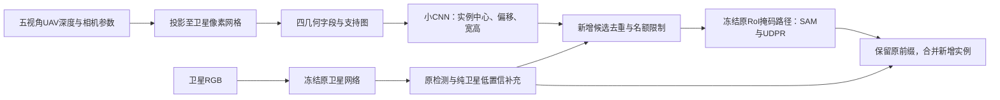

# 已产生实例AP信号的UAV几何候选补充路线

状态：seed44/45完整主比较、三项固定权重输入归因、候选数量控制与总验收均已完成。[最终阶段结论](UE_UAV_EFFECTIVE_DIRECTION_VERDICT_20261024.md)。当前是冻结卫星基座的机制探针，不是已完成联合训练的最终双流模型。

## 1. 核心接口

UAV分支直接预测卫星坐标中的建筑实例框和objectness，原卫星RoI掩码路径使用这些框产生新增实例掩码。UAV证据不经过冻结卫星分类器的前景否决，不修改原卫星特征或已有掩码。

本探针没有使用UAV RGB、CVT或UAV LoRA。已支持的结论限于深度/相机导出的几何证据，不能扩展为UAV RGB外观已有效。

## 2. 几何输入及空间单位

源camera-Z及外参平移cm→m；用UAV内参反投影、camera_to_world变换，再以卫星world_to_camera和内参投影到原生512²像素网格。五视角的投影点按卫星camera-Z取最近已观测表面，不宣称完整目标可见性认证。

五通道输入为：

1. 世界Z减样本中心Z，单位米后除100。
2. 相邻目标像素横向高度差，除10并截断±5。
3. 纵向高度差，同上。
4. 最近表面卫星camera-Z后方1米以内的不同UAV视角数／5。
5. 该像素有无有效保留观测的support。

高度差不是物理坡度；表面包含屋顶、立面、地面。无支持字段为零，support独立保留。网络全图读取这些空间结构，非原RPN anchor中心单点查询。相机参数用于预处理，CNN不直接输入内外参数值。

## 3. 网络与实例解码

复用`ue_geometry_proposal_pilot_20261024.py`的Net：

|阶段|尺寸/通道|操作|
|---|---|---|
|a|256²/16|两次3×3卷积，首个stride2，GroupNorm+GELU|
|b|128²/32|同上|
|c|64²/64|同上|
|d|32²/64|同上|
|融合|128²/160→32|b与上采样c/d拼接，双3×3卷积|
|输出|128²/1+4|中心logit；xy offset；log宽高|

选择中心3×3局部峰、最多250个。offset截到[0,1]，网格宽高由log预测指数化后截到[.25,128]，乘4恢复512坐标，框裁到图像边界。中心附近12×12像素范围没有任何native支持时不提出候选。这是上下文支持，不是每个预测中心精确3D观测认证。

## 4. 直接训练目标

只用已有卫星实例GT框，不需要UAV或BEV标签：

\[
L=L_{\rm center\ focal}+L_{\rm xy\ SmoothL1}+0.1L_{\rm logwh\ SmoothL1}.
\]

中心Gaussian标准差为`clip(min(box_wh_in_grid)/6,1,4)`。同格多个中心回归采用最小面积框，正中心分母按唯一网格cell计。中心focal指数2、负区域衰减指数4。

完整2142train，batch8、每轮drop6图、267更新，10轮2670更新；AdamW1e−3/wd.01、warmup50、cosine至.1、clip.5、AMP初始scale512、无EMA；固定E10 last。该LR用于从零训练的小CNN，与旧LoRA适配器1e−4不同，不能视为旧读取×融合矩阵的同合同消融。几何输入没有光学/空间增强。

seed44：初始化45、epoch1044000+e；独立repeat seed45：初始化46、epoch1045000+e。每个seed内G/K共享完整初始化与逐轮样本顺序。常量控制替换四字段为train-only均值，保留同一support；不是纯卫星或完全无UAV信息。

训练阶段不加载原SAT网络；推理阶段SAT参数/buffer保持原E73状态。原解码器、UDPR和coarse64均未修改。

## 5. 固定推理消费规则

强纯SAT参考先保留原pre2000/post1000的高置信检测，再对原RoI全候选中未保留的假设做补充：原框回归、前景概率排序、对原检测IoU>0.5拒绝、自身NMS0.5、最多填满250。原检测不被替换。

UAV候选先按原高置信检测去重、自身NMS并保留原250剩余名额；为复现缓存原批次，先完整计算这批候选的SAM掩码，再对强SAT参考去重并取其250剩余槽位。实际模型可随后优化无用掩码计算，当前验证保持数值同批次。

强SAT前缀分数严格单调重编码：

\[
r(s)=0.5+\frac{0.5}{1-\log s},\quad s>0;\qquad r(0)=0.5.
\]

新几何假设位于≤.25分数带，按自身objectness排序。实现保留早期FP32分数缩放的数值轨迹以精确复现缓存。所有原前缀检测的相对排名及mask保留，所以AP非下降是保护前缀的设计性质；这本身不证明UAV有用。

这些值是排序分数，不是共同校准后的建筑概率。原始额外候选数与高阈值工作点精度应分开。只有真实字段相对常量、相对同样强的纯SAT控制的配对增量，才支持内容贡献。

## 6. seed44已完成证据

全459test，原始Mask AP×100：

|配置|Mask AP|
|---|---:|
|原SAT pre1000|64.550983|
|SAT pre2000|65.690299|
|强纯SAT补充|66.087884|
|强SAT+常量几何|66.310435|
|强SAT+真实几何|66.551599|

同图bootstrap500、seed20261021、名义95%区间，Mask子项已经完成：

- 真几何−强SAT：+0.463715pp，[+0.293334,+0.586733]pp。
- 真几何−常量：+0.241164pp，[+0.092121,+0.305968]pp。

bbox点值：强SAT70.135330，常量70.295176，真几何70.441578。两seed完整Boundary及四指标配对报告已完成，数值见最终阶段结论。对已有实例mask的边界修正没有发生；当前收益来自新增实例假设及其原掩码路径解码。

固定直接分支也全量公开：SAT2000+真几何66.515066、+常量66.123770；没有根据test从两条路线中挑选。主复核保持更强SAT前缀的已锁定路线。

## 7. 来源与验收

- `/data/wangcheng/checkpoint/ue_geometry_conditional_online_20261024`：在线G/K全test、源快照、身份、原检测恒等；G/K的纯SAT前缀逐字节一致。
- `/data/wangcheng/checkpoint/ue_geometry_confirmation_analysis_20261024`：五个预定test配对比较，既有快速累计器每evaluator前三次抽样校准到原实现≤1e−12。
- `/data/wangcheng/checkpoint/ue_geometry_proposal_repeat_seed45_20261024`：独立随机种子，结构/损失/预算/阈值完全固定。
- `/data/wangcheng/checkpoint/ue_geometry_conditional_repeat_seed45_20261024`：复核在线推理及主配对；可配置运行器先以seed44模型精确复现两张缓存val，再使用seed45模型作原SAT恒等工程门和全test。
- `/data/wangcheng/checkpoint/ue_probe_input_identity_audit_20261024`：36734个归档文件校验和全部匹配，3060个native缓存各自的camera+5 depth来源均匹配同一归档；不等于全库重建或外部几何标定认证。

原RPN研究冻结49份source均未变。两个独立训练seed均复现净增益与正内容差；v1 test已多次参与开发、同城空间相关的限制保留，图像bootstrap不是训练方差区间。后续独立区域数据应另作确认。该探针不宣称解决了UAV RGB外观消费，也不证明几何精确表面对应或最终联合训练一定保留收益。
