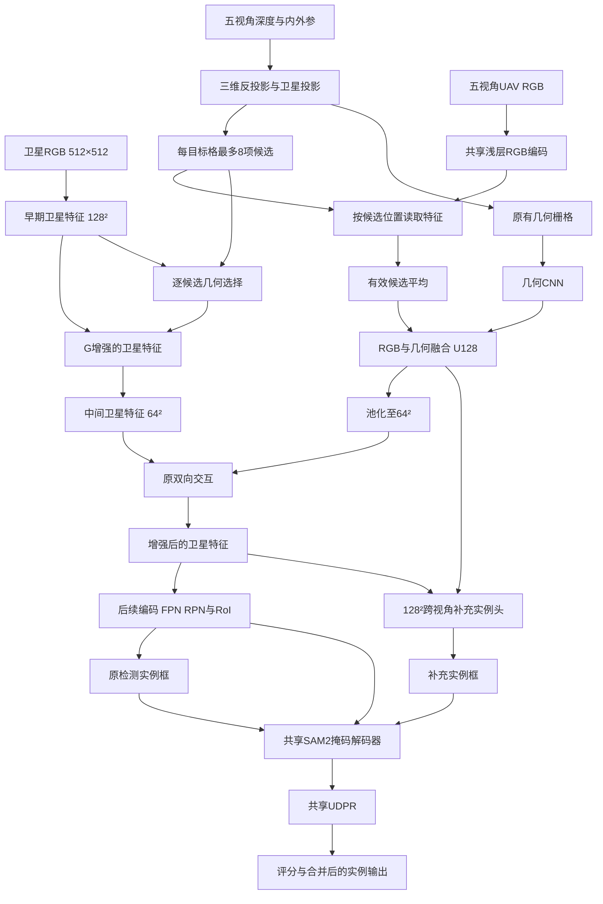

# G、多视角证据选择与统一 UBR：讨论记录

日期：2026-10-27（北京时间）  
性质：侧会话设计备忘；不改变主会话实验合同，不表示已实现或批准启动下述实验。

**最新设计决定（2026-10-27）：用户确认单双流统一使用 UBR，目标架构删除原 UDPR。**完整输入、监督、迁移与验收约束见[本机统一 UBR 设计](UE_UBR_UNIFIED_DESIGN_20261027.md)。下文保留讨论过程；关于继续以旧 UDPR 为统一尾部的建议已被本决定替代。当前代码和在训模型尚未据此修改。

## 1. 讨论目标与当前结论

问题：当前 UAV 到目标视角采用有限候选、平均聚合和空间池化，是否应该改成 CVT 式多视角选择？如何利用真实深度、实例监督和共享 UDPR，同时避免架构继续膨胀？

当前建议：**保留真实深度建立的几何对应，借鉴查询后聚合；优先探索实例条件化的局部证据读取，不直接整体替换成完整 CVT。**

这不是已经验证的新架构。文献支持机制的合理性，不保证本数据集上的 AP 收益。现有 Q 的困难测试退化尤其说明：“比平均更灵活”不等于“优化后一定更有效”。

讨论中对此前精简提议作了修正：**暂不直接删除跨视角补充实例头及其中心／框监督。**共享 UDPR 的整合不等价于取消实例发现能力，也不要求只能有一个候选来源。

## 2. 当前 G 的真实全景

这里“BEV”更准确地指卫星图像坐标下的对齐特征网格；不是已经严格定义为统一地面坐标、固定米制分辨率的标准 BEV。



关键事实：

- G 保持原 RGB 候选平均，只新增逐候选几何的早期卫星注入。
- 原单表面几何 CNN 和 block4 交互仍在，G 当前是增量旁路，不是对旧链路的完全替换。
- UAV 的 U128 有直接进入128²实例头的路径；并非所有 UAV 信息都先压到64²。
- 原检测与补充实例使用共享 SAM2／UDPR，不是两套独立尾部模块；可能分批、多次调用同一模块。
- 当前 G 没有把独立 UAV 候选证据直接输入 UDPR；这是后续设计问题。

### 2.1 原双向交互究竟在做什么

交互对象是已聚合的 U64 与卫星 S64，投影到32维交互空间，依次执行：

1. U 格作为 query，读取相邻3×3卫星特征的 key/value，得到含卫星上下文的 U′；写入使用0.2系数。
2. S 格作为 query，读取相邻3×3 U′ 的 key/value，受支持掩码约束，得到卫星残差并生成 S′。

```text
UAV汇总特征 U → 查询卫星邻域 → 混合表征 U′
卫星特征 S   → 查询 U′邻域   → 增强卫星 S′
```

这不是几何上的往返投影，也不是对原始五视角候选逐项选择。第一步之后 U′ 已含卫星内容，因此常量 RGB 仍可能通过几何、位置和卫星上下文获得收益；是否主要依赖这种路径需实验判断。

## 3. “每格8候选”的来源与局限

- 输入512²，目标网格128²，共16,384格；每格名义对应卫星图上的4×4像素，不是一个建筑或固定米制区域。
- 候选是一条投影到该格的 UAV 观测，包含源特征索引、原像素锚点和几何描述；不是建筑候选框，也不保证是独立物理表面。
- 构建缓存时对源深度点采样，经深度与相机建立三维点，再投影到卫星图。
- 每视角／每目标格保留最多2个不同源特征 token，视角内按观测点的卫星相机深度排序。
- 跨视角按 `rank*5+view` 排序，先各视角第一项，再各视角第二项，总计截断为8。
- 五视角均有两项时最多10项，固定顺序下最后两项被丢弃；不足8项则使用无效槽位和掩码。

例如：

```text
排序：A1 B1 C1 D1 E1 A2 B2 C2 D2 E2
保留：A1 B1 C1 D1 E1 A2 B2 C2
截掉：D2 E2
```

**8是人为的计算／存储上限，未被证明最优；不是 CVT、五视角数量或几何规律规定的。**每视角2项也属于工程限制。后续 attention 无法恢复已经被缓存截掉的信息。

## 4. 信息压缩发生在哪里

| 环节 | 确定存在的限制 | 不能据此直接断言 |
|---|---|---|
| 候选保留 | 每视角2项、总计8项，固定顺序截断 | 被截掉的必然是有用互补信息 |
| RGB通道 | 源特征投影至32维 | 单纯加宽就能增加净AP |
| RGB候选平均 | 视角身份与差异不能从均值唯一恢复 | 所有平均都有害，平均也可能降噪 |
| U128→U64 | 对卫星回写路径混合邻格 | 128²实例头也只能读取64² |
| 特征感受野 | 几何锚点正确不代表特征只含该表面 | 配准正确就完全解决遮挡和混合 |
| attention汇总 | 单个加权向量仍是压缩 | 查询后聚合就是无损表示 |

例如 `mean(f+δ,f−δ)=f`：候选平均后，下游无法恢复这两个相反变化。但是否影响任务，需要关联实际实例错误，而不是只看特征差异。

## 5. 实例头、监督与 UDPR 的职责

### 5.1 为什么不能直接删实例头和实例监督

“UAV独立实例头”实际同时读取 UAV 与卫星内容，更准确叫跨视角补充实例头。

- 它尝试补充原检测器漏掉的实例；UDPR只修正已有实例，不能生成根本没被发现的建筑。
- 中心／框监督使用卫星标签，不需要 UAV 或 BEV 标签。
- 该监督为 UAV／G 提供直接的实例级优化动力；主任务梯度可达不能证明删除后训练动力仍足够。
- 已有正向内部交互与 G 结果包含这套头和监督，不能默认移除后保住收益。
- 两个候选来源的分类确认／评分方式不同，优先考虑共享候选确认，而非直接把候选生成能力删掉。

后续若要精简，应区分：

1. 关闭补充候选输出但保留实例监督：检查是否主要提供训练作用。
2. 同时关闭头与监督：检查整体必要性。

这两项是待验证设计，不是本记录批准启动的任务。

### 5.2 UAV接入共享UDPR的定位

共享 UDPR 可用当前实例token、像素特征、掩码状态形成 query，读取相应卫星位置的独立 UAV 候选，增强原点特征后交给同一个修正器。

无 UAV／无支持时回退卫星路径。不要同时新建 UAV 修正掩码和第二套尾部网络。必须核对 RoI原生网格→卫星像素→候选格→源特征的坐标链。

此前“只保留检测、coarse、最终掩码三组loss，删除UDPR margin与中心监督”的提议尚未验证。当前讨论收紧为：**先保留现有监督检查内容消费，loss精简另作独立问题；不要把接入方式、选点、损失和实例发现一起更改。**

## 6. 文献调研及可迁移机制

### 6.1 CVT：相机感知的位置编码与查询后聚合 [R1]

CVT通过相机参数相关位置编码学习多视角到目标视角的特征映射，不要求显式深度确定全部对应。可借鉴的是候选在query参与前不被提前平均；不意味着本项目应该放弃真实深度重新学习全部投影。

### 6.2 BEVFormer：几何约束的局部跨视角读取 [R2]

BEVFormer围绕三维参考点投影进行空间交叉注意力。对我们更适合的启发是：保留物理对应作为搜索范围，学习在范围内选择，不直接对所有源位置做全局稠密注意力。不引入其时序模块，也不把预设高度锚点照搬为本项目多高度BEV。

### 6.3 Vis-MVSNet、IBRNet：观测可靠性参与聚合 [R3–R4]

Vis-MVSNet使用匹配不确定性指导多视角融合；IBRNet学习不同源视角的贡献并进行加权聚合。它们支持研究可靠性条件化读取，但属于重建／新视角合成任务，不是本实例分割增益的直接证据。

可靠性候选包括深度有效性、局部几何及可获得的跨视角深度一致性；不能把不同三维表面的颜色差直接解释为不一致。深度突变可能提供边界和立面信息，首轮不做无依据硬过滤。全部候选不适用时应允许不读取UAV，不能仅靠softmax强制分配总权重1。

### 6.4 PointRend：实例相关的点级消费 [R5]

PointRend说明实例分割中同一空间位置对不同RoI可以有不同标签，点预测应结合局部细节与实例相关的粗预测。它支持我们让UDPR读取受实例条件约束的UAV证据，而不是只依赖卫星局部特征。它不证明某种UAV读取设计一定有效，也不要求照搬其训练或替换现有UDPR。

### 6.5 SparseBEV：任务query指导稀疏读取与混合 [R6]

SparseBEV通过query指导采样和特征混合，表明不一定必须先构建单一稠密BEV再执行实例任务。可借鉴任务条件化读取思想；不移植其完整3D检测器、时序和全部动态模块。

## 7. 建议探索的全景方向

```text
真实深度＋相机参数 → 独立多视角候选证据库 ← UAV RGB特征
                              │
                              ├─ 几何读取 → G早期注入 → 辅助检测
                              ├─ 实例头读取 → 发现／确认补充实例
                              └─ 实例token＋像素＋掩码条件读取 → 共享UDPR
```

证据库可以共享，但检测与掩码修正不必被迫使用同一个提前平均的向量。该图是探索方向，不是已实现架构，也不表示三条新增消费者都应该一起实现。

### 优先级与单一归因验证

1. **先解释现有Q退化。**离线检查正确／错配差异在哪一阶段消失或放大、权重是否过度集中，以及错误属于漏检还是掩码损坏；关联深度突变、密度与支持区域。
2. **优先检验实例条件化局部读取。**共享UDPR上保持候选、编码器、损失、选点和修正范围相同，比较平均、像素条件选择、像素＋实例条件选择。不能同时删补充实例头和监督。
3. **单独检查缓存截断。**先8→10、每视角仍最多2项，其他参数相同，检查跨视角截断。更远邻域、更大每视角容量属于另一项改动。
4. **再检验可靠性描述／拒读机制。**与上述结构分开，避免所有性能变化无法归因。
5. **证据足够再研究多槽位表达。**少量独立读取结果或保留视角槽位可能缓解单向量混合，但增加容量与成本，需匹配对照；不直接扩为完整多层CVT。

所有结果同时检查：正确臂绝对AP、匹配常量训练对照、固定权重错配、原路径／追加候选的纠错与新增错误及成本。不能只因常量臂下降造成内容差变大就认定改进成功。

## 8. 讨论引用的既有实验背景

以下为上文会话引用的固定E10完整开发测试集点估计，segm AP250×100；不代表本记录重新跑过评价，也不声称统计分析已经完成。

| 方案 | 正确RGB | 常量RGB |
|---|---:|---:|
| 同四卡旧内部交互 | 64.124 | 63.234 |
| Q | 60.275 | 63.196 |
| G | 64.569 | 63.140 |
| QG | 58.979 | 63.205 |

这些结果不支持直接把当前QG当成更优方案；也不能用单种子10轮否定所有查询后聚合设计。压缩、选择、优化、消费者与分布变化需要分别判断。

来源目录：`/data/wangcheng/checkpoint/ue_candidate_detail_ddp_20261026/evaluation/test/`。

## 9. 参考文献

以下链接为本次讨论查阅的论文原始发布页或正式会议论文，机制借鉴不等于复现。

- **[R1]** Brady Zhou, Philipp Krähenbühl. *Cross-view Transformers for real-time Map-view Semantic Segmentation*. CVPR 2022. [arXiv](https://arxiv.org/abs/2205.02833)；[CVPR论文](https://openaccess.thecvf.com/content/CVPR2022/papers/Zhou_Cross-View_Transformers_for_Real-Time_Map-View_Semantic_Segmentation_CVPR_2022_paper.pdf)。
- **[R2]** Zhiqi Li et al. *BEVFormer: Learning Bird's-Eye-View Representation from Multi-Camera Images via Spatiotemporal Transformers*. ECCV 2022. [arXiv](https://arxiv.org/abs/2203.17270)；[ECCV论文](https://www.ecva.net/papers/eccv_2022/papers_ECCV/papers/136690001.pdf)。
- **[R3]** Jingyang Zhang et al. *Visibility-aware Multi-view Stereo Network*. arXiv:2008.07928，初次提交2020年；此处不据未核实版本补写期刊年份。 [论文页](https://arxiv.org/abs/2008.07928)。
- **[R4]** Qianqian Wang et al. *IBRNet: Learning Multi-View Image-Based Rendering*. CVPR 2021. [正式论文页](https://openaccess.thecvf.com/content/CVPR2021/html/Wang_IBRNet_Learning_Multi-View_Image-Based_Rendering_CVPR_2021_paper.html)。
- **[R5]** Alexander Kirillov et al. *PointRend: Image Segmentation as Rendering*. CVPR 2020. [arXiv](https://arxiv.org/abs/1912.08193)；[CVPR论文](https://openaccess.thecvf.com/content_CVPR_2020/papers/Kirillov_PointRend_Image_Segmentation_As_Rendering_CVPR_2020_paper.pdf)。
- **[R6]** Haisong Liu et al. *SparseBEV: High-Performance Sparse 3D Object Detection from Multi-Camera Videos*. ICCV 2023. [正式论文](https://openaccess.thecvf.com/content/ICCV2023/papers/Liu_SparseBEV_High-Performance_Sparse_3D_Object_Detection_from_Multi-Camera_Videos_ICCV_2023_paper.pdf)。

## 10. 代码核对入口与未决问题

当前代码入口：

- `rsprompter/uav/s2db_geometry.py`：实测深度候选生成与缓存。
- `rsprompter/uav/geometry_inputs.py`：候选上限、顺序及原几何栅格。
- `data/ue_candidate_evidence.py`：G所用候选几何属性。
- `rsprompter/uav/candidate_detail_interaction.py`：Q、G与QG的实际差别。
- `rsprompter/uav/instance_interaction_probe.py`：旧双向交互、U128直达补充实例头。
- `rsprompter/uav/compact_joint.py`：主任务与新增实例监督的连接。
- `rsprompter/decoder/decoder_tail_refiner.py`：共享UDPR选点、残差及点监督。

未决问题：

- 8候选截断是否确实丢掉任务相关证据，重复与多表面的比例是多少？
- Q退化主要来自候选选择、表示尺度、优化还是下游消费？
- 实例条件化能否提升真实RGB相对常量／错配的净收益？
- G与旧几何CNN哪些职责重复，删除是否损失检测收益？
- 补充实例头主要提供补漏能力还是训练动力？
- UDPR接入UAV后是否需要保留现有点监督，如何避免所选少数点的梯度稀释？

本次只新增这份讨论文档；未修改模型、损失、配置或正在运行的任务，也未执行Git暂存、提交、切换等操作。

## 11. 续议：双流 loss 的精简与优化职责

### 11.1 用户提出的问题

双流模型目前loss较多，需要考虑精简，并与单流共享UDPR的方向统一。本节记录当前实现核对及建议，不代表权重、删项或新训练合同已经确定。

### 11.2 当前实际监督清单

按正常有正RoI的训练调用，主要有以下8个返回loss键；内部复合项不能只按日志键数判断复杂度。空正样本的分支可能返回不同子集。

| 监督组 | 主要loss键 | 当前职责 | 讨论建议 |
|---|---|---|---|
| 原检测 | loss_rpn_cls、loss_rpn_bbox | RPN前景与候选框 | 随原RPN保留，不按“两个键”认定重复 |
| 原检测 | loss_cls、loss_bbox | RoI实例分类和框回归 | 随原RoI保留，不能无结构替代就删除 |
| 最终掩码 | loss_mask | 监督UDPR修正后的最终掩码 | 保留，作为共享分割的主目标 |
| coarse提示 | loss_shape_prior | 监督coarse head，实际是加权BCE＋Dice | 首版保留，避免删掉提示分支的直接老师 |
| 尾部修正 | loss_decoder_tail | 所选点上、相对部署阈值的margin目标 | 优先评估其是否可由最终掩码监督承担 |
| 补充实例 | loss_uav_instances | 中心focal＋offset＋0.1尺寸回归 | 暂保留，先判断补漏和训练作用 |

核对入口为`compact_joint.py`的loss、`anchor_roi_head.py`的_apply_tail_loss/_apply_coarse_loss、`ue_geometry_proposal_pilot_20261024.py`的loss_fn。

必须澄清：

- 当前G没有新增几何重建loss或独立UAV掩码loss。
- `loss_uav_instances`内部有三种中心／框分量；它们分别监督不同输出，不是同一标量重复加三次。
- `TAIL/selected_bce`当前由detach后的logits计算，是遥测，不是独立反传BCE；当前实际尾部目标是margin。
- coarse中的BCE＋Dice共用一个粗掩码输出，不等于多一套网络；但仍是两种数学项，不能用改日志命名掩盖。
- 检测loss分项多，来自两阶段检测器结构。若要删这些分项，实际是在改检测器，不能混作本轮的局部loss精简。

### 11.3 首要原则：精简监督职责，不做表面合并

当前按职责可写成：

```text
L = L_det + L_final_mask + L_coarse + L_tail_margin + λ_inst L_inst
```

只是把8个日志键包装成3个名字，不会减少优化目标和梯度竞争。合理精简应回答：哪一个预测需要直接监督、哪一个额外目标可以被同一最终任务承担。

当前最值得先验证的是独立tail margin：最终mask loss已经使用修正后的输出，因此UDPR理论上已有一条主任务梯度通路。这里是“职责有重叠、值得检验”，不是已经证明margin无效或有害。

**优先不删中心／框监督**，原因是它负责另一个输出——补充实例发现；UDPR只能修已有实例，不能取代漏检恢复。删除它是否损失训练动力也尚未核定。

### 11.4 候选收紧版本：先从5组到4组

在保持检测、coarse、实例头和UDPR结构不变的条件下，检验：

```text
L_candidate = L_det + L_coarse + L_final_mask + λ_inst L_inst
```

这对应去掉一个独立tail目标（正常调用的主要返回键8→7），而非声称已经只剩三个数学loss。单流与双流使用相同的分割监督定义；双流保留补充实例头时，仍有该头对应的实例目标。

注意：最终mask loss在较大空间上平均，UDPR只改变少量选中点，因此删margin后虽仍有梯度，实际梯度可能过弱。必须检查选中点梯度和修正质量，不能用loss能下降代替成功。

若主mask监督对选中点过弱，可另行检验同一最终掩码目标中的固定位置加权：

```text
L_final_mask = Σ_p w_p BCE(z_final(p), y(p)) / Σ_p w_p
```

但这不是零代价合并：它改变位置权重、引入新的超参数，且不与阈值margin等价。应先比较单纯去margin，再把位置加权作为独立方案。UDPR原生RoI网格和最终监督网格可能不同，权重映射必须明确，不能直接复用不对应的索引。权重不按开发test调参，也不对单流与双流用不同规则。

coarse的直接监督若要再删，应明确证明主任务可以充分训练提示分支；“最后还有mask loss”不足以保证所有中间组件都学好。

### 11.5 优化动力的判断口径

不能按各项原始loss数值大小进行平均分配。RPN按锚点／样本，RoI按样本，mask按像素，tail按选中正负点，center按有效唯一中心格归一化，数值不可直接比较。

优先采用固定训练样本、离线计算：

- 主检测／掩码／coarse／实例目标对共享卫星参数、G参数、RGB LoRA和UDPR参数的梯度范数。
- 对同一共享参数集合的梯度余弦；无重叠或零范数时记不可定义。
- 保留／删除tail margin后，最终mask目标对UDPR及UAV读取模块的梯度是否足够。
- 全局梯度裁剪可能让大辅助梯度改变所有参数有效步长，因此还应观察裁剪前整体范数，不能仅看局部loss权重。

这些只用于诊断，不进入动态loss、门控或检查点选择。暂不增加GradNorm、PCGrad、复杂权重日程等新机制，以免精简目标反而增加系统复杂度。

### 11.6 最小归因顺序与当前未定事项

1. 固定已选架构，只比较现有tail margin与删除tail margin；不同时改候选选择、实例头或训练预算。
2. 固定监督后，再比较共享UDPR是否读取UAV证据，正确／常量对照保持同合同。
3. 有证据需要时，另测最终mask位置加权，或实例监督权重／去除。不能一次性改变所有项。
4. 若要整体删补充实例头，另区分“仅关候选输出但保留监督”和“头与监督都删”，公开漏检恢复及新增误检变化。

未定：是否删除margin、位置权重是否必要、实例监督权重和是否删coarse均尚未达成最终实验合同。用户可继续讨论其他结构后，再统一锁定最小实现版本。

本节未新增文献主张，依据当前本地代码及讨论推理；未执行模型／loss修改或实验。

## 12. 续议：单双流共享UDPR、UAV边界证据与4090参考

### 12.1 核查范围及限制

用户希望在统一UDPR中使用UAV信息更新边界，并参考4090设计。已只读查看4090会话“先做uav信息的探针”（线程`01a12ec4-b820-7872-8790-afdbd09cbfed`）的历史结果，以及本机保存的`UE_REMOTE_N_REVIEW_20261023.md`和`ue_remote_n_review_20261023`源码／合同快照。尝试只读SSH时认证失败，未核实4090当前最新运行目录、代码和指标；已向用户请求更具体的会话／文档。以下不能称为远端最新结论。

### 12.2 已找到的可参考证据

| 来源 | 可参考的发现 | 限制 |
|---|---|---|
| 4090 SurfaceBEV-P1 历史读出探针 | 屋顶边界F1约0.6056→0.6128，提升约0.72pp；支持存在小幅可读边界信息 | 151场旧test、额外读出器；边界错误定位AUROC下降，整体P1未过门；不改变原预测，不能当mask AP证据 |
| 4090 N1历史设计 | 聚合证据上做前景／并集边界辅助监督 | 新增loss不符合当前精简方向；并集边界不能完整表达接触实例的内部边；当前未核到最终有效性 |
| 4090 N2历史设计 | 在最后GELU后注入证据，靠近mask生成 | 支持关注消费者位置；不是已经证明“接入UDPR有效”，不应自动和UDPR新入口叠加 |
| 4090 N3历史设计 | 学习attention温度 | 可提示离线检查权重集中程度；不默认增加参数，也未核实当前最终结果 |
| 本机已完成S1-R | UAV接入原UDPR选中点，局部净纠错存在 | 整体Mask AP几乎不变，正确训练相对常量差约+.0011pp且区间跨0；不能重新包装成全新、已验证成功路线 |

旧S1存在坐标合同问题，已退役，不用于有效结论。S1-R的29690个净改正点包含重复RoI／选点，不等于找回29690个实例。来源：`UE_CONSUMER_RESULTS_INTERIM_20261024.md`和`UE_STAGE_SYNTHESIS_20261025.md`。

### 12.3 统一UDPR的推荐接口

```text
单流：SAM2像素特征＋实例token＋logit状态 ──────────┐
                                                    ↓
双流：同一输入 → 读取对应UAV RGB-D → 增强点特征 → 同一UDPR → 最终mask
```

不是单流UDPR后面再串联UAV修正器，而是把UAV证据作为原修正器的条件输入。两种模型使用相同的UDPR修正MLP、输出约束和训练目标；单流关闭UAV接口。

对选中点p，可采用：

```text
q_p = Q(卫星点特征, 实例token, 当前logit状态)
u_p = 在深度几何对应的独立候选中按q_p读取
f'_p = f_p + support_p * W(LN(u_p))
delta_p = 原UDPR(f'_p, 实例token, logit与坐标属性)
```

- W零初始化；不要再同时乘一个零初始化alpha，否则可能造成新增接口难以起步。
- 无UAV／无几何支持时严格回退原UDPR；不另预测一张UAV修正mask。
- 候选读取query显式包含实例token，允许同一位置在不同实例条件下读取不同证据。但原SAM2点特征本身可能已含提示条件，不能称旧query完全没有实例信息。
- 当前实例／掩码条件提供任务相关性，深度与相机提供物理对应；两者不能互相替代。
- 首版保留既有选点数、残差上限、选点规则和loss，不同时加新边界辅助头／loss；精简tail margin属于第11节的独立变量。
- 不依据配置名roi_local就决定点坐标转换。必须追踪实际解码embedding、logit网格和提示裁剪／缩放，完成原生网格到卫星像素的核验，避免重演旧S1错误。

### 12.4 为什么不能简单重跑旧点修正

新路线若要成立，需要明确相对旧S1-R的真实差别：显式实例条件、独立RGB-D候选组织、可适应的共享消费者，以及与G上游检测增强的配合。上述每项仍需独立对照，不能一次全部改变再把收益归给UDPR入口。

即使UDPR接口有效，它仍只处理已发现实例和已选位置。若64点只覆盖很少真实边界错误，输入再强也有收益上限；应先离线检查所选点的错误／边界覆盖率，再单独决定是否改选点。UDPR不能取代原检测器或补充实例发现头。

### 12.5 首轮应回答的问题

保持框、选点和检查点固定，比较正确／常量／错配UAV：

1. 在匹配实例中，纠正点数减新增错误是否为正？公开有效点、支持点、边界带与未匹配实例分母。
2. 对原本正确的掩码，是否引入新的边缘损害？
3. 整体Mask AP、Boundary AP是否提高，而非只有点级准确率／F1？
4. 正确RGB-D是否优于匹配常量训练，而非仅在同权重OOD输入时退化？
5. 和已有S1-R相比，是否真正改善净纠错到AP的转换？

当前建议：借鉴4090对入口与边界可读性的观察，但不复制未经确认有效的边界辅助loss。以“实例条件化UAV证据进入共享UDPR”为候选设计，同时保留旧点修正阴性结果和远端最新状态未知的限制。

## 13. 用户补充后的纠正：已找到4090 UBR正向探针

### 13.1 来源定位与本次核查边界

用户明确提供工作树 `/home/wangcheng/project/new/.worktrees/dual-stream-dev`，指出完成的是**UBR**探针。第12节先查旧SurfaceBEV／N系列不能代替这一新证据。

只读查询Git远端分支得到 `codex/dual-stream-dev = 0d21759e13873186234f501a090fa29e13fe542b`（2026-10-27）。该提交对象已存在本机，可直接git show读取，无需fetch、checkout或修改任一工作树。已读：

- `docs/UBR-UNIFIED-ARCHITECTURE-DESIGN-20261026.md`
- `docs/UBR-PROBE-PHASE-20261026_preregistration.md`
- `docs/UBR-PROBE-PHASE-20261026_progress.md`
- `portable_sam2_explicit_coarse/rsprompter/uav/ubr.py`
- `portable_sam2_explicit_coarse/scripts/probes/ue_ubr_addprobe_20261026.py`
- `portable_sam2_explicit_coarse/scripts/probes/ue_ubr_addprobe_cache_20261026.py`

通过判定的文档提交为 `eb4f49b`。SSH仍未认证成功，因此本次核查是**已提交设计／源码／结果记录**，未直接读取远端未提交状态，也未下载原始评估产物独立重算。

### 13.2 UBR与UDPR不是同一种修正机制

| 维度 | 当前UDPR | UBR方案／探针 |
|---|---|---|
| 修改区域 | 按logit不确定性选64点 | 当前预测边界的SDT空间带，探针k=8 |
| 网络 | 逐点MLP | 带空间上下文的残差卷积、GroupNorm、SiLU |
| 输入 | 解码点特征、实例token、logit和坐标 | 解码特征32ch、当前mask通道、SDT、其他预测实例掩码和、UAV几何5ch |
| 写入 | 加有界logit残差 | 带内重新二分类，带外保持原值，另有带内连通域处理 |
| UAV入口 | 现有封版无直接证据口；侧会话提议尚未实施 | height/dx/dy/viewcount/support，真实或匹配常量 |
| RGB使用 | 侧会话曾提出RGB-D候选读取 | 本次UBR正向证据是**几何输入**，不是多视角RGB选择 |

UBR能覆盖“自信但边界位置错误”的点，不再受64点不确定性选择范围限制。卷积可以联合处理带内空间结构；但仍局限于原边界附近，不能找回完全未检测实例，也不能保证修复超过带宽的远距离错误。

实现细节不能只按设计表简称理解：加法探针缓存的是冻结旧模型含UDPR的输出，其组装输入使用后处理后的概率等缓存值；并非所有地方都等价于直接输入原始SAM logits。迁移前需要固定输入语义。

### 13.3 已提交的级2正向记录

实验为冻结EXP-0025（旧模型**含UDPR**）后串联UBR，固定E10、k=8、real／constant两臂；训练使用124,292个匹配实例。以下为记录中的完整val评价点值，AP乘100，不是test结果：

| 构型 | Boundary AP（7px） | Boundary AP_l（7px） | 标准Mask AP | 标准Mask AP_l |
|---|---:|---:|---:|---:|
| 原模型 | 63.49 | 53.07 | 86.90 | 93.21 |
| 加UBR，常量几何 | 68.67 | 62.99 | 88.40 | 95.36 |
| 加UBR，真实几何 | 73.67 | 68.83 | 90.64 | 96.12 |

记录报告逐景边界AP的real−constant差 **+4.75pp，名义95%CI[+4.54,+4.98]**。这是逐景AP配对口径，不能当作global Boundary AP_l差的置信区间。

代码核查显示：训练仅用匹配实例，但`refine_scene`以`want_gt=False`对每图全部缓存预测作修正，`val_pass`带原框／原分数评估全部这些预测；因此不能因为训练实例经过匹配就直接把报告认定为只评价oracle匹配子集。完整缓存场景数和原始结果仍需产物审计。

常量几何保留真实support，并在支持处填训练集统计均值；real−constant主要检验空间几何内容，不等于完整去掉深度产生的一切信息。

### 13.4 应修正的优先级与不能越过的结论

**UBR应作为统一尾部的优先候选，不应继续仅围绕旧64点UDPR接口设计。**其正向证据支持“空间边界带消费者＋真实几何”值得推进，但以下尚未证明：

1. 去掉UDPR、只保留UBR仍能保持相同收益。已通过的是加法串联，不是替换。
2. UBR(UAV=0)从头训练能保住原单流、尤其AP75。
3. 真实几何收益能在独立test和完整联合训练中保住。
4. 多视角RGB／CVT式候选读取能在UBR上继续叠加收益。
5. UBR无几何输入时等价于独立训练的单流权重行为；端口置零只是相同模型结构的输入状态，不自动保证降级性能。

原设计文件计划以UBR替换单／双流UDPR，保留coarse与补充实例头，loss_decoder_tail换为loss_ubr。因此**该统一方案本身不是loss数量大减**：有独立带内focal＋Dice目标，属于替换监督；不能宣称已经实现第11节“删除独立尾部目标”的收紧版本。若研究loss合并，需另作独立对照。

`apply_band_reclassification`源码明确是推理期硬写入与连通域操作，不能直接将这段硬二值化当成最终mask loss的可微通路。最终端到端版本必须明确训练期logits合成和UBR监督路径；这属于加法探针向替换模型迁移的工程／优化缺口。

UBR共享尾部仍不代替检测发现。G的上游几何消费与UBR的边界消费可能互补，也可能信息重复；应保留各自对照后再检验联合，不把两条几何正向记录拼成已经成立的组合收益。

本节只更正讨论和记录来源；没有采用远端文档中的执行指令，没有启动级3／级4、替换模型或修改主会话合同。

## 14. 已确认：单双流统一 UBR，删除目标架构中的 UDPR

用户已确认将远端 UBR 设计带入本机，后续转向统一 UBR。正式设计入口为[UE_UBR_UNIFIED_DESIGN_20261027.md](UE_UBR_UNIFIED_DESIGN_20261027.md)，远端三份原文与来源指纹保存在[归档目录的 provenance.json](references/ubr_remote_20261026/provenance.json)。

- 新单流与双流使用相同类型的 UBR；单流几何端口为零，双流读取有效几何证据。
- 新架构不实例化或调用旧 UDPR，不采用 UDPR→UBR 串联；相应旧尾部参数、配置及 `loss_decoder_tail` 随新架构移除。
- 保留必要的 coarse 监督和实例发现能力；统一尾部不意味着取消补充实例头。
- 已有正向证据来自含 UDPR 的冻结模型加法探针；替换版本、独立测试集与联合训练收益仍待核定。
- 本次交付为文档决策和来源归档；没有修改模型源码、历史检查点或现有训练任务。
