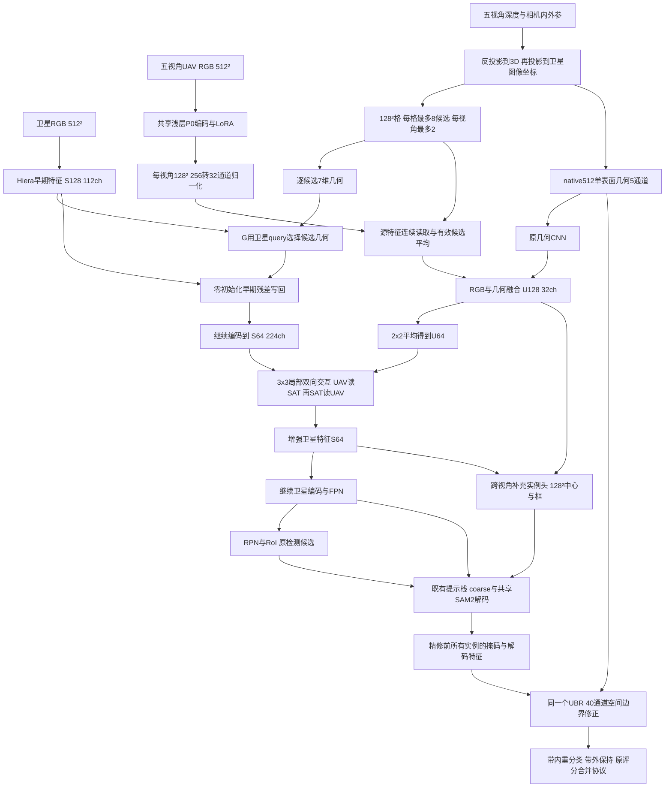

# 完整G＋统一UBR双流：结构展示与独立审查

日期：2026-10-27。基于e557d61收敛设计；G等上游为已有实现，UBR替换与端到端组合为拟实现版本，不是已跑通新模型。用户要求单个独立子代理审查，审查任务`independent_full_g_ubr_review`。

## 1. 全景数据流



图中G查询仅选择几何，RGB仍有效候选平均；没有接入退化的Q。共享SAM/UBR表示一个模型内原候选与补充候选复用模块/权重，不表示独立训练的单双流权重相同。额外候选未自动走统一RoI分类，本轮保持原策略，不能画成已实现统一候选确认。

## 2. 三处UAV消费及交互

| 位置 | UAV内容 | 卫星如何参与 | 主要职责/限制 |
|---|---|---|---|
| G早期128² | 每候选7维几何 | 112维卫星内容生成32维query，候选几何产生key/value，汇成32维再投影112维写回 | 几何增强后续编码/检测；无RGB候选选择、无完整3D |
| 原64²内部交互与128²补充头 | 平均后的RGB＋几何CNN | U查询3x3 SAT，再SAT查询混合U；头同时读U128与S增强特征 | 主任务与补漏；常量RGB仍可利用SAT/几何求解 |
| UBR尾部512² | 5ch几何栅格 | 32ch实例解码特征、当前概率、SDT、其它预测邻居共同卷积 | 对已有实例空间带精修；首版没有直接多视角RGB端口 |

5ch为height/dx/dy/viewcount/support；7ch为目标offset2、相对worldZ、源cameraZ、yaw cos/sin、相对本格最近锚点的SAT cameraZ差。它们不是同一张几何表达，也不是可见性真值。

UBR当前状态/SDT/邻居stop-gradient，解码特征可微。UBR连续输出与原mask在带内/外合成，最终mask与UBR带内目标可回传decoder及上游G/旧交互；补充头的离散框生成/NMS不因此可微。

## 3. 保留与丢弃的信息

- 数据原始5RGB+5深度+内外参用于构造，不代表全像素都进入网络。
- 候选仍是每视角2/总8，固定排序截断；10项时最后两项不能被后续attention找回。
- 源RGB只走浅层P0与256→32，候选平均混合视角/表面；U64回写路径再平均2x2，U128直接实例头仍在。
- G在几何汇总前看到候选差异，但其输出仍一个加权32维向量。
- UBR的5ch栅格已做单表面归并，不携带完整多表面/逐视角RGB；512²分辨率不等于保留完整三维信息。
- UBR使用k8像素带，带外不改；超带错误、完全漏实例、原框限制均不能靠尾部保证解决。

## 4. 监督账本

```text
L = RPN_cls + RPN_bbox + RoI_cls + RoI_bbox + mask_final
  + .1*(coarse_BCE + coarse_Dice)
  + .1*(UBR_focal_gamma2 + UBR_Dice)
  + 1*(center_focal + offset + .1*logwh)
```

删除UDPR与tail margin；不新增RGB/深度重建辅助。UBR监督覆盖预测带，不以几何support筛掉无支持位置。所有GT仅训练/评价用，预测SDT/邻居不能由GT边界代替。原loss沿既有分母，UBR带内/实例/图归一化按收敛合同。不以系数大小替代梯度审计。

关键历史事实：补充头有中心/框监督，但原CompactJoint训练mask来自卫星RPN/RoI样本；新增补充框主要在推理掩码路径消费。保留现合同不代表这个分布差已解决。

## 5. 开工前必须核定的接口

1. **训练邻居来源**：预测上下文必须明确候选集合、self排除、重复实例与分数处理。仅训练正RoI/GT分配无法自动等同全预测邻居，尤其密集误检场景。是否以无梯度预测旁路形成上下文、如何复用feature和控制额外成本，仍是工程待决。
2. **补充候选UBR训练覆盖**：不能因为中心loss存在就认定UBR训练见过补充候选误差；需公开覆盖与错分类型。若增加这些候选的mask监督，应单列合同修订，不能暗中改变本轮单变量。
3. **连续输出/阈值**：训练损失用哪个绝对logit、推理相对边界分数/0分数回退及带外保持需统一，首步不保证连续恒等。
4. **网格与资源**：RoI原生decoder到卫星512²几何对齐必须闭环；GroupNorm裁剪不等价。训练仅分块forward再统一backward仍保留激活，需真实梯度资源门，必要时激活checkpoint；推理250实例单独测。

## 6. 对照与结论边界

沿S/D0/Dc/Dr：S纯卫星UBR0；其余完整G/实例头相同，UBR端口分别0/常量/实测。Dr-Dc测尾部几何内容，不证明RGB额外价值；完整RGB主张需要匹配上游RGB训练/干预对照。Dr-S检验总系统，不能归给单一模块。G与远端UBR各自正向不能相加为组合预期收益；首先核替换UDPR的S与D0，不把加法探针认作替换通过。

独立审查报告保存路径：`/data/wangcheng/checkpoint/ue_positive_recovery_20261026/independent_full_g_ubr_review.md`。报告结论形成后以原文为准；本文件为主代理结构展示，不代替独立评价。

## 7. 独立审查最终结论

独立代理建议“有条件推进”，认可早期检测增强＋补充发现＋空间形状精修的分工，但不认定无压缩、无冗余或组合收益已证实。必须先补齐训练预测邻居/self排除、补充候选训练覆盖、阈值/空满mask、带内重分类初始化/梯度及真实反传资源合同。源实现估算约42.6G MAC/实例、250约10.65T MAC（卷积理论量，非设备实测），不能凭参数少认定成本低。

原始审查按字节保存在[独立报告](reviews/UE_G_UBR_INDEPENDENT_REVIEW_20261027.md)。主代理核对同意上述限制。尤其保留：UBR替换在带内切断原z的直接梯度，仍经decoder feature间接训练；零输出层首步前层梯度为零，需多步真实梯度门，不能声称连续恒等。首版不另加Q/RGB-UBR/辅助loss，先按S/D0/Dc/Dr做替换与几何内容核定。
