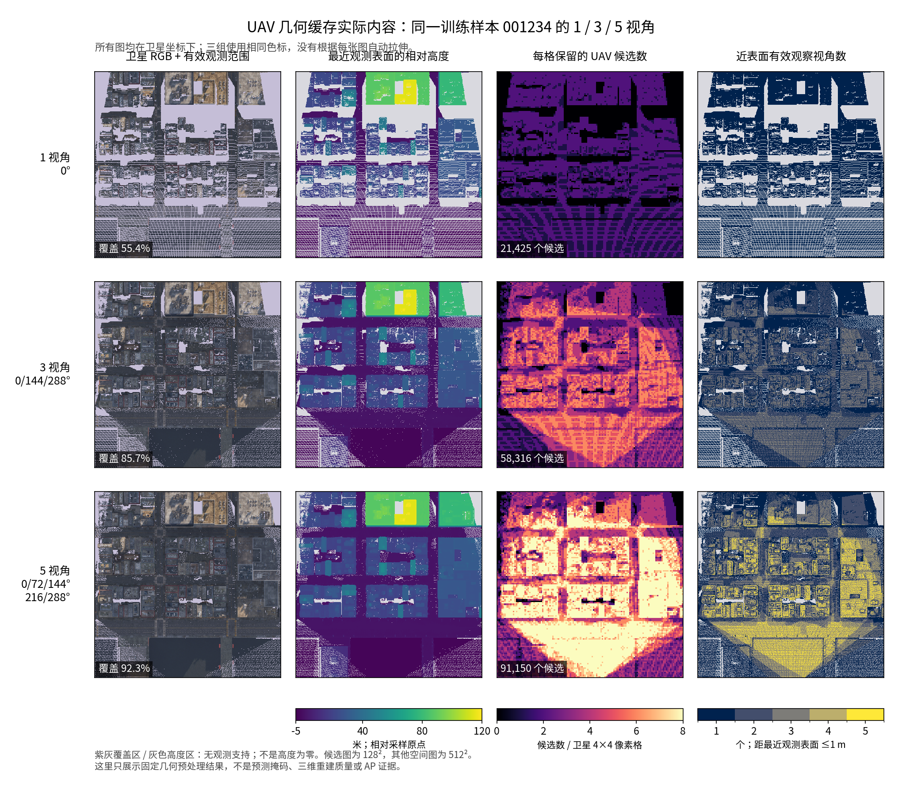
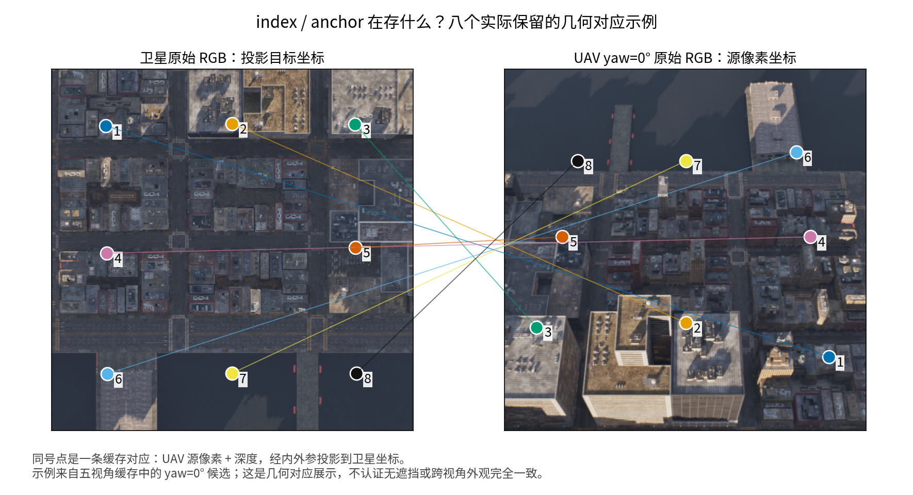

# 论文写作备忘录：UAV 辅助卫星实例分割与三维重建的研究边界

- 整理日期：2026-10-28（Asia/Shanghai）。
- 用途：后续 Introduction、Related Work、Method、Discussion 和审稿回复的表述依据；不是正式论文稿，也不是新增实验协议。
- 来源：本次侧会话关于几何缓存、可视化、三维重建及论文定位的讨论。
- 范围：只记录论证路径与已有展示，不修改模型、数据、训练合同或实验队列。

## 1. 已明确的写作决策

**论文主线：深度引导的跨视角特征融合，用于 UAV 辅助的卫星建筑实例分割。**

1. 承认方法使用三维反投影和相机几何，不将方法描述为“完全二维”“无三维处理”或“完全隐式 CVT”。
2. 将深度和标定的作用界定为跨视角对应、观测几何描述与特征传递；研究输出和监督落在卫星坐标下的实例预测。
3. 当前不以构建完整、可渲染的三维场景模型为中间任务；没有用于场景重建的统一网格或体场优化。
4. 用户已明确：**后续不追加本次讨论提出的三维重建路线对照实验。** 这不构成新的实验待办。
5. 相应限定主张：不宣称优于“先重建再分割”，不宣称保留全部三维信息，不宣称已经证明重建没有必要。
6. 核心实证问题保持为：真实 UAV 证据是否改善卫星实例分割，以及哪些交互与消费路径对该改善有贡献。

三维对照是否需要，取决于具体声明和投稿范围，不能从本文档推导出“审稿人必然不会要求比较”。本备忘录采用收紧声明来建立自洽范围，不以文献代替本项目的收益证据。

## 2. 原始数据、几何缓存和完整重建的关系

### 2.1 当前已有数据能做什么

每个样本有卫星 RGB、卫星实例标签、五视角 UAV RGB、对应 camera-Z 深度和相机内外参。深度、标定及单位正确时，可以反投影得到已观测表面的彩色三维点云；进一步可做表面融合。已知深度和位姿使这个起点不同于仅有 RGB、还需估计深度与位姿的 SfM/MVS 问题。[Open3D 点云生成文档](https://www.open3d.org/docs/release/python_api/open3d.geometry.PointCloud.html)、[Open3D TSDF 融合文档](https://www.open3d.org/docs/latest/tutorial/t_reconstruction_system/integration.html)

但五视角不保证所有建筑表面被观测。遮挡、背面、屋檐下区域、远处小目标的采样不足，不能仅靠融合变成可靠观测。补洞得到封闭网格，也不等于缺失部分被真实扫描。经典体积融合研究区分了观测融合与补洞，并讨论未充分扫描的尖角、薄表面等限制。[R5](https://lightfield.stanford.edu/papers/volrange/)

### 2.2 缓存为什么存在，训练如何使用

缓存是固定几何计算的预计算结果，不是重新渲染，不是学习特征的离线替代。

- UAV RGB 在训练时实时编码，源 LoRA 仍可学习。
- 提供的深度与内外参用于生成候选锚点和目标坐标下的几何描述，训练时读取对应缓存。
- 可以在每次训练中现场执行相同几何计算；在输入、精度和规则相同时，应与缓存计算等价。缓存主要减少重复投影、排序和筛选开销。
- “使用深度”不等于“完整原始深度图进入可学习深度编码器”。当前链路主要通过对应关系和派生几何使用深度。

| 缓存字段 | 形状 | 含义与单位 |
|---|---|---|
| `index` | `16384×8` | 卫星 `128×128` 网格每格最多八个源特征候选；无效为 `-1`；token 保留源相机槽位身份 |
| `anchor` | `16384×8×6` | 源像素 u/v、源 camera-Z、卫星投影 u/v、卫星 camera-Z；像素坐标及米；FP64 |
| `geom` | `16384×8×6` | 基础归一化偏移、高度、深度、yaw 方向描述；不同通道单位不同，不应统一称为米 |
| `fields` | `4×512×512` | 相对采样原点的高度/100、截断的横/纵高度差/10、近表面观察者数/5 |
| `support` | `512×512` | 至少有一个有效深度点投影到该卫星像素的支持标记 |
| 来源记录 | 元数据 | 所选视角、原始文件与代码 SHA、缓存版本及单位等 |

`geom` 的缓存六维基础描述不等于 G 分支实际消费的七维候选描述；后者还根据当前保留锚点计算额外的最近锚点深度差。写 Method 时应以最终接线为准。

### 2.3 当前表示与三维场景重建的区别

| 维度 | 当前任务表示 | 场景重建通常关注的表示 |
|---|---|---|
| 起点 | RGB-D 和相机几何 | 可同样使用 RGB-D 和相机几何 |
| 三维反投影 | 有 | 有 |
| 保留形式 | 有限候选对应、卫星网格上的观测几何、图像特征 | 点云、表面网格、体素或其他场景表示，具体随方法变化 |
| 多层结构 | 候选中有限保留；高度图压成最近观测单表面 | 三维表示可保留位于不同高度/方向的不同表面 |
| 下游读取 | 面向卫星网格、检测候选和实例 RoI | 场景表示可供几何查询、渲染及进一步感知 |
| 本文评价 | 卫星实例分割 | 本文不评价重建完整度或表面精度 |

三维重建不必总有三维真值、重建 loss 或迭代优化；没有这些模块本身并不是分类标准。本文的区分依据是**学习目标、中间表示的用途与最终输出**。

当前八候选上限、每视角两候选、最近表面高度与特征均值聚合都有压缩。不能将其描述为完整信息保留；也不能在没有比较时认定更完整的三维表示对分割没有用。另一方面，三维几何不会自动给出建筑类别、实例归属与卫星标签定义下的实例掩码；三维实例分割本身仍需要感知机制。[R6](https://arxiv.org/abs/2210.03105)

### 2.4 改变视角数为何要重建缓存

1／3／5 视角敏感性对应分别训练，而不是仅在五视角模型推理时删图。选择子集后，需要在投影和筛选之前移除其他深度观测，再重新计算候选、最近表面、高度差、支持区域和视角计数。

只删除 RGB 但复用五视角几何，会保留被删除视角的信息；只过滤旧 top8，也找不回先前被其他视角挤掉的候选。缓存因此按精确视角 ID 隔离。

`geometry.shape=(1,5,512,512)` 中的 5 指五个几何通道，**不是五个视角**。观察者数维持固定 `/5` 单位，分子只含实际选中且位于最近观测表面 1 m 内的相机；单个观察者编码为 .2，不随子集大小重新归一化。

## 3. 文献依据：几何引导感知与场景重建可以明确区分

以下是文献机制的概括；“对本项目的支持”是基于这些机制的研究定位推论，不是原作者对本项目的结论。

| 编号 | 文献机制 | 可支持的论述 | 不可照搬的论述 |
|---|---|---|---|
| [R1：CVT](https://openaccess.thecvf.com/content/CVPR2022/html/Zhou_Cross-View_Transformers_for_Real-Time_Map-View_Semantic_Segmentation_CVPR_2022_paper.html) | 相机感知的位置编码和跨视角注意力，学习目标地图视角的语义表示 | 跨视角表征可以由下游语义任务驱动，而不以场景表面恢复为输出 | 本项目使用显式深度，不能声称继承 CVT 的纯隐式几何映射 |
| [R2：LSS](https://arxiv.org/abs/2008.05711) | 图像特征经深度分布提升至三维，再聚合到 BEV 用于语义感知 | 有三维中间运算不等于以几何重建为研究目标 | LSS 的具体效率、鲁棒性与性能结果不能直接转移到本项目 |
| [R3：DETR3D](https://proceedings.mlr.press/v164/wang22b.html) | 三维查询借助相机变换索引二维图像特征，最终预测目标框 | 三维几何可以承担特征寻址/关联作用，不必估计稠密场景几何 | 本项目需要给定深度，不能套用 DETR3D 不依赖稠密深度预测的输入优势 |
| [R4：SG-BEV](https://openaccess.thecvf.com/content/CVPR2024/papers/Ye_SG-BEV_Satellite-Guided_BEV_Fusion_for_Cross-View_Semantic_Segmentation_CVPR_2024_paper.pdf) | 深度、点云生成和重投影将街景特征映射到 BEV，再与卫星特征融合，做建筑属性分割 | 与本项目最接近的定位依据：几何服务于跨视角特征传递，研究落点是卫星视角理解 | 建筑属性语义分割不等于建筑实例分割；街景结果不证明 UAV 路线有效 |

建议 Related Work 以**卫星建筑实例分割**和**跨视角表示/融合**为两条直接主线。三维重建简要交代范围即可；无须将其描述为不适合本任务的技术。

## 4. 论文叙述路径

### 4.1 问题定义

设卫星图像为 `I_sat`，所选 UAV 图像为 `{I_i}`，给定深度和标定为 `{D_i,K_i,T_i}`，则研究目标为：

```text
Y_sat_hat = f_theta(I_sat, {I_i}, A({D_i, K_i, T_i}))
```

`A` 是固定的对应关系/支持/观测几何构建过程。模型学习如何消费这些信息以预测卫星实例，而不将完整场景表面作为需要估计的未知量。

### 4.2 Introduction 的因果顺序

1. 卫星实例分割存在尺度、局部外观歧义与观测条件带来的困难，具体改善对象由实验确定。
2. UAV RGB-D 提供额外的外观和观测几何，但与卫星图像有显著视角差异。
3. 核心困难是空间对应、特征交互与实例级消费，而不只是增加一个编码分支。
4. 本文使用给定深度和标定建立对应，将 UAV 线索注入卫星任务表征与实例预测。
5. 用卫星分割、内容对照与路径归因实验支持贡献；不把覆盖增加、非零梯度或分支接通当作净收益。

### 4.3 Method 的组织

**建立对应 → 跨视角特征交互 → 实例预测与统一尾部消费。**

- 几何对应构建：深度反投影、候选/锚点、支持和描述。
- 源表征与交互：可学习 RGB 特征、G 路径与实例辅助目标，按最终保留结构说明。
- 实例消费：在明确卫星/实例坐标上采样并由 UBR 消费，说明 S/U/T/C 的路径开关。

本段为写作框架，不是在本侧会话新增或修改任何模型设计。

### 4.4 推荐术语

| 推荐术语 | 使用说明 |
|---|---|
| 深度引导的跨视角特征融合 | 方法总定位 |
| 深度与标定派生的跨视角对应缓存 | 当前几何缓存 |
| 卫星坐标下的观测表面几何描述 | 高度、局部高度差、支持等 |
| 几何锚定的特征读取 | 原候选与锚点引导的 UAV 特征采样 |
| 卫星条件的跨视角交互 / 实例条件的证据消费 | 仅对实际具备相应条件输入的模块使用 |

不建议用“完整城市重建”“完整建筑三维表示”“保留全部 RGB-D 信息”。不建议将当前整条链路叫作“无三维方法”或简单称“reconstruction-free”，以免遮蔽真实反投影；如需此类英文表述，必须具体限定为“不需要显式场景表面重建”。当前卫星坐标网格也不能不加说明地等同于严格水平地面的 BEV。

## 5. 可直接改写进论文的文本

以下均为本次讨论形成的原创草稿，不是文献原文。最终需根据定稿模型和已完成结果调整。

### 5.1 中文引言动机

> 卫星视角下的建筑实例分割可能受到尺度、局部外观歧义和观测条件的影响。配准 UAV 多视角 RGB-D 观测提供了额外外观与表面几何线索，但显著的视角差异使这些线索难以直接被卫星实例预测过程利用。本文研究如何利用给定深度和相机标定建立空间对应，并将 UAV 观测转化为卫星特征交互及实例掩码预测可消费的信息。

这里的“可能受到”是动机，不是在没有证据时宣称某类误差已被解决。

### 5.2 中文方法范围声明

> 本文研究配准 UAV RGB-D 观测辅助的卫星建筑实例分割。我们利用给定的深度与相机标定建立跨视角对应，并提取目标图像坐标下的观测几何描述，使 UAV 外观及几何线索能够参与卫星特征交互和实例掩码预测。该过程包含几何反投影，但不构建或优化用于场景重建的统一三维表面或体场。本文的实验结论限定于所提供观测对卫星实例分割的作用，不涉及其相对于三维重建路线的性能或信息完整性优势。

### 5.3 英文范围声明

> We study satellite-view building instance segmentation assisted by calibrated multi-view UAV RGB-D observations. Given depth maps and camera calibration, we establish cross-view correspondences and derive observed-surface geometry in the satellite image frame. These quantities support feature transfer and interaction with satellite representations and instance mask prediction. Although the pipeline uses geometric back-projection, it does not construct or optimize a unified surface or volumetric scene model for reconstruction. Our claims concern the contribution of UAV observations to satellite-view instance segmentation; they do not establish superiority over reconstruction-based pipelines or complete preservation of the available 3D information.

### 5.4 Discussion 中的信息压缩声明

> 为限制候选规模并适配目标图像上的消费入口，当前实现采用有限候选、局部特征聚合及最近观测表面的几何描述。这些操作会压缩原始多视角信息。因此，本文不将该表示视为场景几何的完整替代，也不将分割任务中的有效性解释为完整三维信息已被保留。

### 5.5 可选标题方向

- 中文：深度引导的跨视角融合用于 UAV 辅助卫星建筑实例分割。
- 英文：Depth-Guided Cross-View Fusion for UAV-Assisted Satellite Building Instance Segmentation。

标题只界定研究方向，不预先保证创新性或增益。

## 6. 审稿回应边界

### Q1：已有深度和标定，为什么不先三维重建？

> 给定 RGB-D 与标定，融合三维表面是可行的。本文考察的是这些已观测线索如何通过几何对应参与卫星视角的实例预测，而不是如何恢复完整场景表面。我们采用面向目标图像的特征传递与交互路径，并通过卫星实例分割实验验证其作用。本文不主张该路径优于先重建再分割，也不主张其保留了全部三维信息。

### Q2：有反投影和高度图，为什么不算三维重建？

> 本文确实使用三维几何计算，并从深度导出观测表面描述。我们区分的是这些运算在方法中的角色：它们提供对应关系和任务特征，而本文没有构建用于场景重建的统一表面/体场，也不优化或评价重建结果。因此，本文将该过程界定为几何引导的跨视角表征，而不是完整场景重建。

### Q3：三维重建是否会保留更多信息、获得更好分割？

> 三维场景表示可能保留当前压缩表示未利用的结构信息。本文未对这类路线作比较，因此不判断其相对分割性能或信息完整性。本文验证的范围是所采用跨视角消费机制对卫星实例预测的作用。

### Q4：没有三维标签是不是放弃重建的理由？

不是。重建不必依赖三维实例标签；三维表示也可能通过投影后的二维任务监督参与学习。本文不以“没有三维标签”作为排除重建路线的理由，而是明确问题定义和声明范围。

### Q5：可以用效率作为主要回应吗？

不能在未比较时声称比重建更快或更省。重建同样可以离线缓存。可以报告本系统实际测得的成本，但不将其扩大为跨路线效率优势。

| 可以表达 | 不应表达 |
|---|---|
| 给定几何支持跨视角对应与消费 | 不使用三维几何 |
| 没有显式场景表面/体场重建阶段 | 已证明三维重建没有必要 |
| 本项目实验证实的卫星任务增益 | 优于没有比较过的重建路线 |
| 有限候选和观测几何是一种任务表示 | 所有 UAV 信息已被完整利用 |
| 已观测区域具有投影支持 | 已完整恢复建筑或认证全部遮挡关系 |
| 按实际结果说明净收益来源 | 仅凭辅助头精度、梯度或覆盖率宣称成功 |

## 7. 本次可视化及可引用图注

### 7.1 数据来源与适用范围

本节是同一张真实训练样本的缓存可视化，不是概念示意图，不是预测分割结果，也不是新增 AP 实验。

- 数据目录：`/data/wangcheng/dataset/CitySample_SatUAV_TrainMinimal_v1_20261021/points/001234`。
- 缓存根目录：`/data/wangcheng/checkpoint/ue_native_sutc_engineering_20261028/view_subset_cache`。
- 图像与缓存为本次绘图读取时的快照；摘要记录具体缓存 SHA。后续数据版本改变时不能自动沿用数值。
- 原图表目录：`/home/wangcheng2021/.codex/visualizations/2026/10/28/01a18195-db6d-73f0-8ec8-ad8758d61451/uav_cache_001234`。
- 为便于后续写作，PNG/PDF、绘图脚本和摘要已复制到本文件旁的 `paper_assets/cross_view_positioning_20261028/`；见 [来源与文件 SHA](paper_assets/cross_view_positioning_20261028/provenance.json)。

### 7.2 图 1：不同视角数下的观测覆盖与缓存内容



[图1 PDF](paper_assets/cross_view_positioning_20261028/cache_overview.pdf)

**建议中文图注：** 同一训练样本在预定 1、3、5 个 UAV 视角下的几何缓存可视化。每行依次展示卫星图像上的投影支持区域、最近观测表面相对采样原点的高度、目标网格每格的保留候选数，以及距离最近观测表面 1 m 内的观察视角数。三组共享色标。紫灰/灰色无支持区域不表示零高度；候选网格为 128×128，其余空间图为 512×512。本图展示观测和表示的差异，不评价三维完整度或实例分割收益。

**Suggested English caption:** Geometry-cache visualization for one training sample under predefined subsets of one, three, and five UAV views. Columns show projected observation support over the satellite image, the nearest observed surface height relative to the sampling origin, retained candidates per target-grid cell, and the number of observing cameras within 1 m of the nearest observed surface. Color scales are shared across rows. Unsupported regions are shown separately and do not indicate zero height. The candidate grid has resolution 128×128; the other spatial maps have resolution 512×512. This visualization does not measure reconstruction completeness or segmentation performance.

| 所选 yaw ID | 支持像素 / 262144 | 投影支持率 | 有效候选槽 / 131072 |
|---|---:|---:|---:|
| 0 | 145316 | 55.4337% | 21425 |
| 0、144、288 | 224727 | 85.7265% | 58316 |
| 0、72、144、216、288 | 241881 | 92.2703% | 91150 |

读图注意：

- 高度相对于渲染采样原点，不是建筑离地高度；该例存在少量负值是坐标基准的结果，不能仅据此判深度错误。
- 支持表示有效点投影到像素，不是完整遮挡认证，更不是“92.3% 的三维建筑表面被重建”。
- 图中的条纹/空洞展示当前离散投影与观测支持，不能只据图推断标定正确或错误；对应关系质量需另有检查。
- 本例覆盖随视角数增加而增加，不证明全数据集每个样本单调，更不证明 AP 随视角数单调。
- 观察视角数从缓存 `/5` 通道还原，三组使用同一单位；不是分别按 1、3、5 归一化后的覆盖比例。

### 7.3 图 2：实际保留的几何对应



[图2 PDF](paper_assets/cross_view_positioning_20261028/anchor_correspondences.pdf)

**建议中文图注：** 五视角缓存中来自 yaw=0° 相机的八条保留对应示例。同号点表示 UAV 源像素及其 camera-Z 经相机标定投影到卫星坐标后的对应。示例按预设的目标网格位置选取附近候选，而不是按预测效果或标签筛选；图像直接使用原始卫星/UAV RGB。该图解释 `index/anchor` 的寻址含义，不认证无遮挡或跨视角外观完全一致。

**Suggested English caption:** Eight retained correspondences from the yaw=0° camera in the five-view cache. Matching labels connect UAV source pixels to their satellite-frame projections using the provided camera-Z depth and calibration. Examples are selected near predefined target-grid locations, without selecting on predictions or labels. The figure illustrates geometric feature addressing and does not certify complete visibility or appearance consistency.

详细坐标、源 token、相机轴向深度和缓存 SHA 见 [visualization_data.json](paper_assets/cross_view_positioning_20261028/visualization_data.json)。[绘图脚本](paper_assets/cross_view_positioning_20261028/render_cache.py) 的输入为上述固定本地路径；重绘需要 NumPy、Pillow、Matplotlib 和可用的 Noto CJK 字体。本次展示无需重跑训练或重建全量缓存。

## 8. 主张—证据对应与后续写作使用方式

| 将来想写的主张 | 本备忘录能提供什么 | 仍须来自项目结果的证据 |
|---|---|---|
| 方法属于深度引导跨视角感知 | 文献定位、目标/表示/输出边界 | 定稿接线与输入合同应一致 |
| 缓存保留空间对应和观测几何 | 图1/图2、字段、数值与来源 SHA | 不替代全量标定或遮挡审计 |
| UAV 对卫星实例分割有净帮助 | 只提供问题定义 | 完整正式评价和匹配对照的 AP 差异 |
| 真实内容被消费 | 只提供概念区分 | 既定内容对照/干预证据；固定权重干预与配对训练不混用 |
| 某路径改善掩码或检测 | 模块角色的写作组织 | 相应消融、固定框与误差分解等已完成证据 |
| 更完整三维表示不必要或不如本文 | 无证据，不作此主张 | 当前不追加该对照，因此不写该结论 |

论文定稿时：把本文件的范围声明用于定位，把项目已有的最终冻结结果用于性能论证；不要将这份讨论备忘录当成训练完成、因果验证或新实验授权。

## 9. 参考文献与引用键

均为原论文/作者官方页面；核对日期为 2026-10-28。本文没有使用二手博客作为技术依据。以下机制描述为转述，无长段逐字摘录。

- **R1 / `Zhou2022CVT`**：Brady Zhou and Philipp Krähenbühl. *Cross-View Transformers for Real-Time Map-View Semantic Segmentation*. CVPR, 2022, pp. 13760–13769. [CVF](https://openaccess.thecvf.com/content/CVPR2022/html/Zhou_Cross-View_Transformers_for_Real-Time_Map-View_Semantic_Segmentation_CVPR_2022_paper.html)；[作者论文 arXiv](https://arxiv.org/abs/2205.02833)。用于相机感知跨视角表征定位。
- **R2 / `Philion2020LSS`**：Jonah Philion and Sanja Fidler. *Lift, Splat, Shoot: Encoding Images From Arbitrary Camera Rigs by Implicitly Unprojecting to 3D*. ECCV, 2020. [作者论文 arXiv](https://arxiv.org/abs/2008.05711)；[官方项目](https://nv-tlabs.github.io/lift-splat-shoot/)。用于说明三维特征提升与任务表征的关系。
- **R3 / `Wang2022DETR3D`**：Yue Wang, Vitor Campagnolo Guizilini, Tianyuan Zhang, Yilun Wang, Hang Zhao, and Justin Solomon. *DETR3D: 3D Object Detection from Multi-view Images via 3D-to-2D Queries*. Proceedings of the 5th Conference on Robot Learning, PMLR 164, 2022, pp. 180–191. [正式论文及官方 BibTeX](https://proceedings.mlr.press/v164/wang22b.html)；[官方项目](https://tsinghua-mars-lab.github.io/detr3d/)。**会议通常称 CoRL 2021，正式 PMLR 出版年为 2022；BibTeX 统一用 2022。**
- **R4 / `Ye2024SGBEV`**：Junyan Ye, Qiyan Luo, Jinhua Yu, Huaping Zhong, Zhimeng Zheng, Conghui He, and Weijia Li. *SG-BEV: Satellite-Guided BEV Fusion for Cross-View Semantic Segmentation*. CVPR, 2024. [正式 PDF](https://openaccess.thecvf.com/content/CVPR2024/papers/Ye_SG-BEV_Satellite-Guided_BEV_Fusion_for_Cross-View_Semantic_Segmentation_CVPR_2024_paper.pdf)；[作者论文 arXiv](https://arxiv.org/abs/2404.02638)。用于几何引导卫星/街景特征传递这一最近任务背景。
- **R5 / `Curless1996Volumetric`**：Brian Curless and Marc Levoy. *A Volumetric Method for Building Complex Models from Range Images*. SIGGRAPH, 1996. [作者官方论文页与全文入口](https://lightfield.stanford.edu/papers/volrange/)。用于观测融合、表面重建与补洞的边界说明。
- **R6 / `Schult2023Mask3D`**：Jonas Schult, Francis Engelmann, Alexander Hermans, Or Litany, Siyu Tang, and Bastian Leibe. *Mask3D: Mask Transformer for 3D Semantic Instance Segmentation*. ICRA, 2023. [作者论文 arXiv](https://arxiv.org/abs/2210.03105)。用于说明三维实例感知并不由几何重建自动完成。**不要与 Hou 等人的同名 CVPR 2023 预训练论文混淆。**
- **技术参考**：[Open3D PointCloud API](https://www.open3d.org/docs/release/python_api/open3d.geometry.PointCloud.html)、[TSDF Integration](https://www.open3d.org/docs/latest/tutorial/t_reconstruction_system/integration.html)。用于解释给定 RGB-D/标定的可实现几何操作，不作为本文分割收益证据。

可复用的六篇论文 BibTeX 见 [references.bib](paper_assets/cross_view_positioning_20261028/references.bib)。条目仅填写本次核实的元数据，未猜测缺失的 DOI 或页码。
