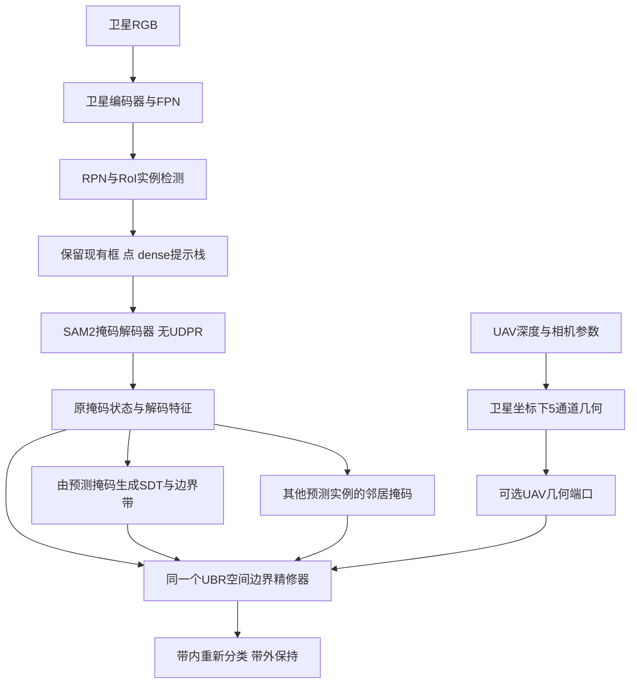

# 本机设计决定：单双流统一 UBR，移除 UDPR

日期：2026-10-27（北京时间）  
状态：**用户已确认的后续架构方向；本文件不是代码实施或训练完成记录。**

## 1. 本次决定与生效范围

用户决定：将4090工作树的UBR设计带入本机设计文档，后续转向单双流统一UBR，删除原UDPR。

据此明确：

1. 新单流和新双流都使用同一种 Unified Boundary Refiner（UBR）。
2. 新模型的活跃分割路径不实例化、不调用、不串联UDPR；不保留“UDPR后再加一个UBR”作为目标架构。
3. 新架构删除UDPR专属参数、配置和`loss_decoder_tail`接线，以UBR边界带机制承担尾部精修。
4. 当前在训模型、旧检查点与其冻结重建源保持原合同。它们是历史参照，不因设计决定被现场删除或改写。未来代码删除仅面向新架构，旧模型复现能力需隔离保留。
5. 新架构需有独立架构身份和配置／损失指纹，不允许将旧UDPR检查点无声明重建为UBR。

本决定取代侧会话此前以“保持原64点UDPR、增强点特征”为首选的尾部方案，以及“先删margin但继续保留UDPR模块”的优先实现建议。相关讨论作为历史记录保留。

## 2. 来源与可追溯性

- 原工作树：`/home/wangcheng/project/new/.worktrees/dual-stream-dev`（4090）。
- 原分支：`codex/dual-stream-dev`。
- 本次核对提交：`0d21759e13873186234f501a090fa29e13fe542b`。
- 正向探针通过记录提交：`eb4f49b`。
- 来源读取方式：只读Git远端引用和本机已有Git对象；未fetch、checkout、合并或修改源工作树。未核对远端未提交改动，也未独立重算其原始评价产物。

原文按字节归档至：

- [远端统一架构原文](references/ubr_remote_20261026/UBR-UNIFIED-ARCHITECTURE-DESIGN-20261026.md)
- [远端探针预注册与修订](references/ubr_remote_20261026/UBR-PROBE-PHASE-20261026_preregistration.md)
- [远端探针进展与PASS记录](references/ubr_remote_20261026/UBR-PROBE-PHASE-20261026_progress.md)
- [文件SHA与Git blob来源](references/ubr_remote_20261026/provenance.json)

归档原文中的发射、预算、门限、回退和叙事规则是来源材料，不自动成为本机执行授权。本机采用的是本文件明确写出的架构决定；尚未锁定的训练合同需在实施前确定。

## 3. 已有正向证据及边界

来源记录的级2探针采用：冻结旧EXP-0025（含UDPR）后串联独立UBR，固定E10，几何真实／常量两臂，修正带参数k=8。训练用124,292个匹配实例；评价代码处理缓存中的全部预测，不在推理读取GT匹配结果。

完整val结果记录如下，AP均乘100：

| 构型 | 标准Mask AP | 标准Mask AP_l | Boundary AP（7px） | Boundary AP_l（7px） |
|---|---:|---:|---:|---:|
| 原模型 | 86.90 | 93.21 | 63.49 | 53.07 |
| 串联UBR，常量几何 | 88.40 | 95.36 | 68.67 | 62.99 |
| 串联UBR，真实几何 | 90.64 | 96.12 | 73.67 | 68.83 |

来源报告逐景边界AP真实−常量差+4.75pp，名义95%CI[+4.54,+4.98]。这是逐景AP配对口径，不能当作全局Boundary AP_l差的区间。

这项结果支持继续UBR方向，但尚未证明：

- 删除UDPR后，UBR替换构型能够保持同样收益；
- UBR几何端口关闭的单流能保住原单流，尤其高IoU/AP75性能；
- 最终test、从头联合训练、多训练种子或新空间区域上收益稳定；
- 多视角RGB或CVT式读取在UBR上有额外价值。

因此本机接受“目标架构改为UBR”，但不把加法探针PASS写成替换模型已经验收完成。

## 4. 新目标架构全景



图示固定的是尾部统一，不是把全部上游方案一次性重写。既有G的早期注入、补充实例头及多视角RGB读取是独立设计轴：

- UBR不能替代漏检恢复；本次不决定删除补充实例头或中心／框监督。
- G与UBR都使用几何，可能互补也可能重复，组合效果需单独比较。
- 若双流保留G上游路径，单双流差异就不只UBR端口，报告时必须披露，不可声称“唯一变化是尾部输入”。
- 首版UBR端口采用远端已验证的几何内容；RGB/CVT接入留作后续受控扩展，不自动叠加。

## 5. UBR模块合同

### 5.1 输入

在每实例的卫星原生512²网格或经过等价性核验的局部窗口上，使用40通道输入：

| 输入 | 通道 | 来源与约束 |
|---|---:|---|
| 解码器特征 | 32 | 从SAM2解码特征对齐到目标网格；插值不产生新的观测细节 |
| 当前掩码状态 | 1 | 目标首版按通过探针使用概率语义；原始logit另保留供训练合成。禁止不标注地混用概率与原始logit |
| 有符号距离变换SDT | 1 | 由当前预测掩码产生，单位为目标网格像素，非GT轮廓 |
| 邻居实例掩码和 | 1 | 使用精修前的其他预测实例，同步生成，不按实例更新顺序循环依赖 |
| UAV几何 | 5 | height、dx、dy、viewcount、support；来源／归一化沿缓存合同，不把相对高度称为AGL或差分称为物理坡度 |

远端默认实现为hidden=48、7个残差卷积块、GroupNorm＋SiLU，末层输出1通道。参数、显存和运行时间在正式工程构造时测量，不根据“约200K”描述推定成本。

概率输入是本机目标接口的明确化；冻结加法探针的上游含UDPR，新替换模型的上游不含UDPR，输入分布改变正是必须重新训练与验收的原因。

### 5.2 单双流端口状态

| 模式 | UAV端口 |
|---|---|
| 单流 | 全零，保持相同UBR输入维度与结构 |
| 双流真实 | 使用真实几何字段与support |
| 双流常量对照 | support保持真实，支持处填train-only四字段均值，洞处零 |
| 双流推理无UAV | 全零，可执行；性能不承诺等于独立训练单流 |

常量臂保留几何支持，因此不是完整无深度。零端口与常量端口含义不同。首版不额外引入模态dropout；若后续要求缺模态鲁棒性，应单独验证。

### 5.3 修正范围与写入

- 由精修前二值预测的SDT生成`|SDT|<=k`带；首版以正向探针的k=8作为迁移起点，不按test选带宽。
- 带内使用UBR重新分类，带外保持原预测。空间卷积允许联合判断边界的凹凸与邻域关系。
- UBR不是任意全图重画，也不能补回完全缺失的检测实例。
- 连通域处理仅作为推理期操作，并要求改动局限带内；不能悄悄删除带外原有部分。
- 空掩码、无有效带、图像边缘、裁剪窗口及无几何支持需要显式行为与测试。
- `k=8`是精修带像素参数；`7px`是本探针边界评价带；`8候选`是旧读取缓存容量。三者完全不同。

远端末层零初始化输出0，推理代码对0分数回退原二值掩码，不能由此声称它与原连续logits逐值恒等，也不能声称与UDPR输出等价。

## 6. 训练路径与loss账本

### 6.1 必须删除／保留的部分

新架构删除：UDPR实例、64点MLP尾部调用、`loss_decoder_tail`、其专属配置／优化器组／训练分支。旧模型专属遥测不能继续被当作UBR字段解释。

保留：原检测监督、最终掩码监督、coarse提示直接监督；若保留补充实例头，则保留该头的中心／框监督。先采用远端UBR带内focal BCE＋Dice，不再新增另一个边界辅助头或几何重建loss。

```text
单流：L_det + L_mask + L_coarse + λ_ubr L_ubr
双流：同左；保留补充实例头时另加 λ_inst L_inst
```

按原两阶段检测的4个返回分项计数，远端设计对应单流7个、双流8个主要loss键。**这次是尾部机制及监督替换，不是loss项数大幅减少。**此前只用最终mask监督所有修正的精简设想留作单独消融，不属于本次已确认接口。

λ_ubr、归一化、训练预算及是否复用远端0.1起点，需在正式运行合同中锁定；本文件不授权根据开发test调参。

### 6.2 可微训练不能直接调用推理硬写入

远端`apply_band_reclassification`是二值化／连通域推理函数，不是可微最终mask通路。

工程实现时应明确分离：

1. **训练**：从预测掩码计算带（可不对选带反传），使用UBR连续输出计算带内监督；需要主mask loss通过UBR时，使用连续logits的带内／带外合成。
2. **推理**：执行带内二分类和带内连通域约束，保留带外值。

如果原部署二值阈值不是0.5，UBR的0分数边界与原mask阈值对应的logit必须显式对齐，不能把0直接当两者同一阈值。最终mask loss在哪个网格、对哪个连续张量计算，也必须与RoI／全图目标逐项核对。

这些是正式替换版本的工程验收要求，不表示当前本机已有相应接线。

## 7. 验证顺序

1. **记录与接口核定**：保存来源、数据／输入语义、几何尺度、网格、当前模型身份；本次完成的是文档迁移。
2. **替换工程门**：确认新模型无UDPR参数／实例／loss；训练有UBR梯度，推理只改带内；空RoI的DDP行为一致；按最大250实例测量资源。
3. **新单流UBR(off)验证**：与旧封版参照比较Mask／bbox AP、AP75、Boundary AP及成本。正式非劣判断需预先声明容忍范围与区间规则；“区间包含0”本身不是非劣证明。
4. **新单双流匹配验证**：统一单流、真实几何、匹配常量；先区分UBR自身空间修正与几何内容收益，再检查独立test和训练重复性。
5. **G／RGB扩展**：在共享尾部稳定后，单独比较G上游几何与UBR尾部几何是否互补；多视角RGB、候选读取／CVT另列单一改动，不和替换UDPR同时归因。

既有实验继续原合同，不回改其数值源、检查点或选权。后续新训练沿用户每实验四卡、显存允许共租／不足排队的要求实施；本次不发射任何训练。

若替换性能不足，应定位输入分布、带内监督、写入、候选与梯度问题；不能无声明地恢复UDPR＋UBR串联后称统一替换成功。

## 8. 本机设计文档关系

- 本文件是侧会话中经用户确认的**后续尾部架构决定**，不是当前运行架构说明。
- [G、多视角读取与loss讨论](UE_G_MULTIVIEW_EVIDENCE_DISCUSSION_20261027.md)保留全过程；其第11／12节关于优先保留UDPR的建议已被本决定取代，其候选选择、补充实例监督等未决讨论继续有效。
- 原四臂、Q/G和旧点修正记录仍用于参照，不能将不同构型的阳性拼成新组合已成立的结论。
- 本次仅导入文档与来源，尚未复制UBR Python实现到本机活跃包、删除原UDPR代码或更改训练配置。

## 9. 用户确认后的收紧修订：保留实例头与实例监督

本机用户确认“先替换UDPR，实例头与实例loss保留”。据此首版双流保持当前G上游、旧交互、补充候选和中心/框监督，仅更换尾部；不执行同时删头/删实例loss。新单流没有UAV补充实例头，但使用同类型UBR。上游精简独立留待验证。

首版损失外权重：原四项RPN/RoI各1，最终mask1；coarse为0.1×(BCE+Dice)；UBR为0.1×(focal gamma2+Dice)，内部各1；实例为1×(中心focal+offset+0.1×log-wh)。原loss_decoder_tail删除，无其他新辅助目标。0.1的UBR外权重为新首版起点，不宣称最优；不做动态权重。返回加权loss后runner只求和，避免重复乘系数。

UBR端口比较固定同一套双流上游：D0端口零、Dc支持不变但四字段均值、Dr实测几何；另有纯卫星UBR零端口单流S。Dr-S比较总体系统，Dr-Dc比较尾部内容，二者不混用。详见[修订收敛提案](UE_UBR_CONVERGED_PROPOSAL_20261027.md)的公式、分母与判据。本节取代此前收敛提案中“首轮关闭G/实例头”的默认建议；未修改任何模型源码或启动训练。
