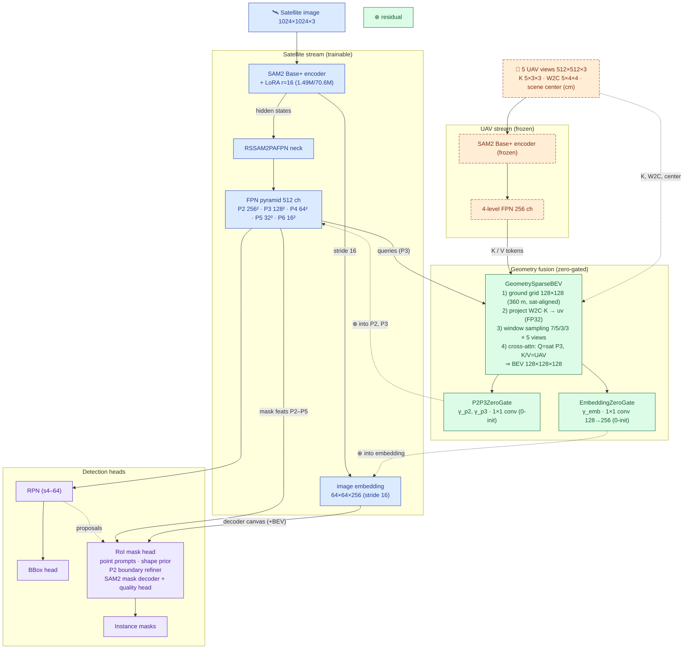

# Dual-Stream (UAV→Satellite) Architecture Notes

Design intent: use UAV oblique views of the *same scene* to enhance
satellite-view instance segmentation. All fusion is geometry-faithful (known
intrinsics/extrinsics, no learned alignment) and zero-gated (baseline exactly
preserved at init), so any metric change is attributable to UAV content.

## Streams

### Satellite stream (trainable)
1. **Encoder** — SAM2 base_plus + LoRA (r=16, qkv/proj, ~1.49M / 70.6M trainable).
   Outputs: stride-16 `image_embeddings` (64×64×256), backbone-FPN high-res
   features (s4/s8), hidden states.
2. **Neck** — `RSSAM2PAFPN`: five 512-ch maps at strides 4/8/16/32/64
   (P2…P6). P2 = 256×256, P3 = 128×128 for 1024² input.
3. **Heads** — RPN (all strides) → proposals; BBox head (RoIAlign s4–32);
   RoI mask head: point prompts (`point_emb` on mask feats), shape-prior
   injector, P2 boundary refiner (uses P2 directly), SAM2 mask decoder +
   quality head. The decoder attends to `image_embeddings` — the only direct
   feature path to final mask logits.

### UAV stream (frozen)
4. **Encoder** — a second SAM2 base_plus, frozen, same pretrained weights as
   satellite init. Consumes 5 oblique 512² views (yaw 0/72/144/216/288°).
   Produces a 4-level 256-ch FPN.

### Geometry fusion
5. **GeometrySparseBEV** — builds a 128×128 ground grid covering the same
   360 m square as the satellite tile; projects each ground point through
   W2C + K into the 5 views (FP32, autocast disabled — cm-scale world
   coordinates overflow fp16); samples K/V tokens in windows 7/5/3/3 across
   all views/levels; cross-attends with satellite-P3 queries →
   BEV 128×128×128.
6. **P2P3ZeroGate** — `γ_p2`, `γ_p3` (zero-init scalars) × 1×1 convs inject
   the BEV residual into P2 (bilinear-upsampled) and P3.
7. **EmbeddingZeroGate** (r3 variant, `UE_DUAL_INJECT_EMBEDDING=1`) — same
   contract into the stride-16 `image_embeddings` (1×1 conv 128→256,
   zero-init γ_emb). Puts UAV information on the mask decoder's main canvas.

## Loss
`L = L_rpn_cls + L_rpn_bbox + L_cls + L_bbox + L_mask + L_shape + L_p2br (+ L_quality)`

## Optimizer groups
sat_backbone (LoRA) · mask_decoder · shape_prior · p2_boundary_refiner ·
quality_head · sat_other · **drone_guidance** (geometry_bev + p2p3_gate +
embedding_gate, lr×1.0). UAV encoder excluded (frozen).

## Monitors (per epoch)
`dual-stream monitor: valid=… point_valid=… bev[mean/max]=… γ[p2/p3]=…
γ_emb=… injected_ratio[p2/p3]=… injected_ratio_emb=…`

r1 lesson: valid=0% / γ=0 for the whole run (fp16 overflow) — these fields
exist so a dead fusion branch is visible in epoch 1.

## Mermaid

Variants: **r1** (dead fusion, fp16 overflow — superseded) · **r2**
(P2P3ZeroGate only) · **r3/emb** (P2P3 + EmbeddingZeroGate). All share seed
44 / 128 train scenes / 259 val scenes with the single-stream control
(best segm/mAP 0.7312).
